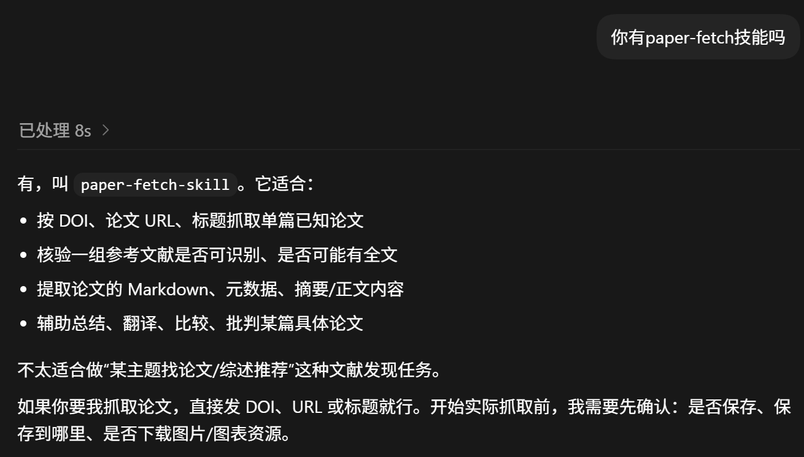
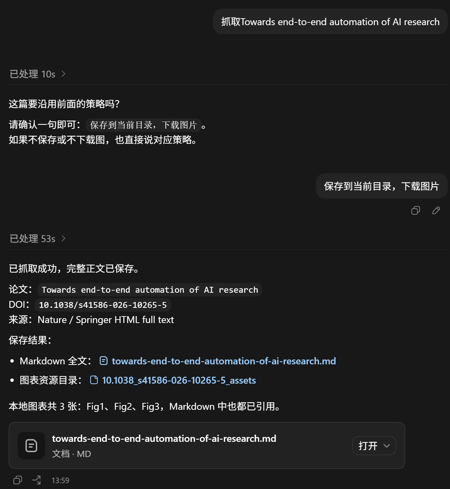
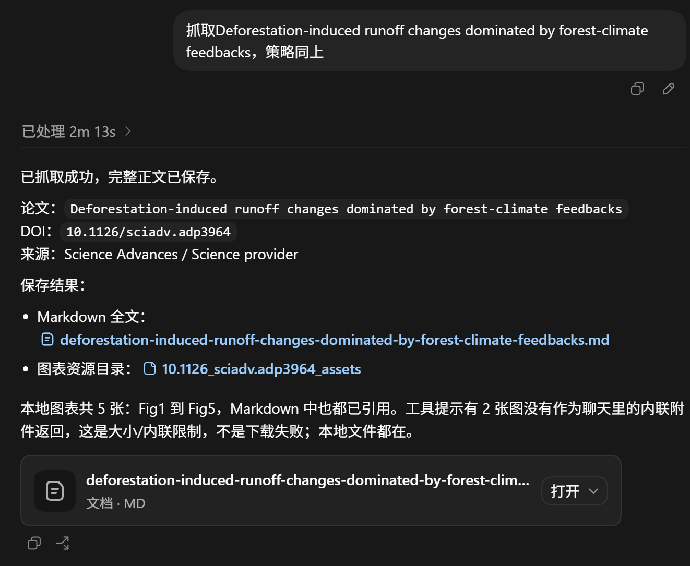

# Paper Fetch Skill

> Fetch papers as agent-ready markdown — DOI/URL/title in, structured full text out. CLI · MCP · Skill.

**Paper Fetch Skill** 是已知论文的 AI 阅读层：输入 DOI、URL 或标题，在你已有合法访问权限的范围内，返回结构化元数据、Markdown 全文和可选图表资源，让 Codex、Claude Code 或任意 MCP host 从“只能读摘要”升级到“可以读全文”。

```text
DOI / URL / title
        ↓
受支持 provider 的官方 HTML/XML → 验证后的 PDF fallback
        ↓
Sections · formulas · tables · references · local assets
        ↓
Markdown · structured article · quality diagnostics
```

## 为什么不只是 PDF → Markdown

Paper Fetch 将论文身份解析、provider 路由、官方结构化全文与 PDF fallback 连接起来，并统一报告获取和内容质量。

| 维度 | Paper Fetch | 单一 PDF → Markdown 路径 |
| --- | --- | --- |
| 输入入口 | DOI、URL、标题、arXiv ID 或引用条目 | 已取得的 PDF |
| 首选内容源 | 受支持 provider 优先使用官方 HTML/XML，失败时再走验证后的 PDF fallback | PDF 文本层、版面和 OCR |
| 论文结构 | 统一为 metadata、sections、references、assets 和 quality | 取决于具体转换器及 PDF 版面 |
| 公式 | 源站提供 MathML/TeX 时转换并规范化；失败时保留公式图片或缺失诊断 | PDF 公式恢复能力取决于具体转换器 |
| 图表资源 | 发现、下载、验证、本地链接改写并报告失败或降级 | 图片导出和链接方式取决于具体转换器 |
| References | 全文/出版社 references 优先，保留 raw、DOI、标题和年份等可得字段 | 引用顺序和字段恢复取决于 PDF 版面与工具 |
| 质量可见性 | 区分正文充分性、表格/公式语义损失和资产质量 | 诊断范围取决于具体转换器 |

## 快速开始

源码 checkout 内安装完整能力并抓取一篇论文：

```bash
python -m pip install ".[full]"

paper-fetch fetch \
  --query "10.1186/1471-2105-11-421" \
  --output-dir ./papers
```

`--query` 可以是 DOI、论文 landing URL 或标题。未显式传 `--output` 且指定 `--output-dir` 时，CLI 会在目录中生成安全命名的主输出；默认 Markdown 模式会保留全文 references，并按 `body` 资产范围尝试归档正文图表资源。全文不可用时，结果会标明仅摘要、仅元数据或具体失败原因。

只需要临时把 Markdown 输出到终端、不归档论文资产时：

```bash
paper-fetch fetch \
  --query "10.1186/1471-2105-11-421" \
  --format markdown \
  --output - \
  --output-dir ./.paper-fetch-tmp \
  --artifact-mode none \
  --asset-profile none \
  --include-refs all \
  --max-tokens full_text
```

CLI 默认在终端 stderr 显示逐篇阶段和资产进度；`--progress text|jsonl|none` 可显式选择输出，`--progress jsonl --control-stdin` 提供机器单篇/整批取消接口，见 [`docs/cli.md`](docs/cli.md#实时进度与机器取消)。

CLI 会准备工作目录；MCP 临时阅读预设不保存独立 Markdown 或下载论文资产，但运行时仍可能写入缓存和浏览器状态。完整输出和落盘矩阵见 [`docs/cli.md`](docs/cli.md) 与 [`presets.md`](skills/paper-fetch-skill/references/presets.md)。

### 独立获取补充材料

```bash
paper-fetch fetch --target supplementary --query "10.1038/s41561-022-00912-7" --output-dir ./papers
```

只需要补充附件、Source Data、Extended Data 或多媒体时，使用 `--target supplementary`，无需先取得正文，也不下载正文 PDF。随正文获取补充材料则使用默认的 `--target paper` 和 `--asset-profile all`。Python API 与 MCP 单篇、批量入口也支持 `target="supplementary"`；材料范围、输出及失败语义见 [CLI 说明](docs/cli.md#独立补充材料任务)。

## 你会得到什么

- 带 YAML front matter 的论文 Markdown，包含题名、作者、期刊、DOI、来源和正文状态。
- 按源文档恢复的摘要、正文 section、表格、公式、figure caption 和 references。
- `asset_profile=body|all` 时可下载的正文或补充资源，以及改写后的本地 Markdown 链接。
- JSON、MCP 和 manifest 中统一的 acquisition、content、asset 和 semantic-loss 诊断。
- 当全文、公式、表格或资产不完整时，明确的 warning、质量状态和稳定 reason code。

项目提供三个入口：

| 入口 | 适用场景 |
| --- | --- |
| `paper-fetch` | 单篇或批量本地抓取与归档 |
| `paper-fetch-mcp` | Codex、Claude Code 等 MCP host 内的结构化调用、缓存和批处理 |
| `skills/paper-fetch-skill/` | 告诉 agent 何时调用、如何选择预设以及如何验收结果 |

## 效果展示

agent 安装 skill 后，可以识别 Paper Fetch 的适用边界，按用户意图选择临时阅读、归档或探测，并核验实际正文和资产。



以下示例来自真实开放抓取产物。

### Nature 示例

- 论文：Towards end-to-end automation of AI research
- DOI：`10.1038/s41586-026-10265-5`
- 来源：Springer/Nature HTML full text
- 许可：[`CC BY 4.0`](https://creativecommons.org/licenses/by/4.0)
- Markdown 全文：[`towards-end-to-end-automation-of-ai-research.md`](figures/towards-end-to-end-automation-of-ai-research.md)



### Science Advances 示例

- 论文：Deforestation-induced runoff changes dominated by forest-climate feedbacks
- DOI：`10.1126/sciadv.adp3964`
- 来源：Science Advances / Science provider
- Markdown 全文：[`deforestation-induced-runoff-changes-dominated-by-forest-climate-feedbacks.md`](figures/deforestation-induced-runoff-changes-dominated-by-forest-climate-feedbacks.md)



## 安装

面向最终用户，推荐从 [GitHub Releases](https://github.com/Dictation354/paper-fetch-skill/releases) 下载离线安装包：

- Windows：`paper-fetch-skill-windows-x86_64-setup.exe`
- Linux：与本机 CPython ABI 匹配的 `paper-fetch-skill-offline-linux-x86_64-cp*.sh`
- macOS 15+ Apple Silicon：与本机 CPython ABI 匹配的 `paper-fetch-skill-offline-macos-arm64-cp*.tar.gz`

官方安装包安装后，运行 `paper-fetch update` 即可更新到最新正式 Release：Linux/macOS 自动升级，Windows 下载校验后打开安装向导，并预选当前安装目录。同版或当前版本更新时直接退出。

源码安装可选择 core、`browser`、`pdf` 或 `full` 能力。安装命令、离线包校验、平台矩阵、升级、卸载、Python ABI、Gatekeeper 和 quarantine 处理见 [`docs/deployment.md`](docs/deployment.md)。

## 单篇、批量与 Agent 接入

批量抓取时准备一个每行一个 query 的文件：

```text
10.1186/1471-2105-11-421
https://www.nature.com/articles/s41559-026-03039-9
```

```bash
paper-fetch fetch \
  --query-file ./queries.txt \
  --output-dir ./papers \
  --batch-concurrency 4
```

批量结果会按输入顺序原子写入 `batch-results.jsonl`；单篇失败会被记录，不会阻止其它条目继续。需要正文图时使用 `--artifact-mode markdown-assets --asset-profile body`，随正文获取补充材料时将 asset profile 改为 `all`；只获取补充材料时加 `--target supplementary`。

将本仓库接入 Agent：

| Host | 命令 |
| --- | --- |
| Codex | `./scripts/install-codex-skill.sh --register-mcp` |
| Claude Code | `./scripts/install-claude-skill.sh --register-mcp` |
| Antigravity CLI | `./scripts/install-antigravity-skill.sh --register-mcp` |

需要自定义环境文件、project/user scope 或手动 MCP 注册时，见 [`docs/deployment.md`](docs/deployment.md)。

## 访问权限与运行时

Paper Fetch 不绕过付费墙或访问授权。可用性取决于 provider、用户凭据、机构访问状态和本机运行环境。

- Elsevier API 路线使用从 <https://dev.elsevier.com/> 申请的 `ELSEVIER_API_KEY`；ScienceDirect 浏览器路线使用浏览器访问状态，API key 不赋予浏览器访问权限。
- 浏览器路线使用受管 Byparr（Windows/Linux x64 为 Invisible，macOS/ARM 为 Camoufox）；登录或订阅权限仍由用户提供。安装器默认准备平台支持的浏览器，准备、跳过和独立重试命令见 [部署指南](docs/deployment.md#浏览器安装与准备)。
- `paper-fetch doctor` 只做本地静态诊断；`paper-fetch browser-preflight` 才会启动浏览器并访问 provider 页面；需要建立或更新登录状态时运行 `paper-fetch auth <provider>`。

```bash
paper-fetch doctor
paper-fetch browser-preflight
paper-fetch auth wiley
```

浏览器后端、认证、显式 runtime 准备和平台限制见 [`docs/browser-runtime.md`](docs/browser-runtime.md) 与 [`docs/browser-backends.md`](docs/browser-backends.md)；provider 的当前能力和环境要求见 [`docs/providers.md`](docs/providers.md)。

## 项目边界

- 只负责已知论文的身份解析、全文获取、验收和报告，不替代开放式主题检索、文献推荐或综述生成。
- 结构化公式转换依赖源站提供 MathML/TeX；只有图片或 PDF 排版信息时，不承诺恢复可靠 LaTeX。
- PDF 转换输出保持原样，不做格式清洗或内容修复，见 [PDF 转换边界](docs/extraction-rules.md#rule-pdf-conversion-boundary)。

## 文档

- [`docs/cli.md`](docs/cli.md)：CLI 输出、artifact、批量抓取和错误码。
- [`docs/deployment.md`](docs/deployment.md)：安装、配置、MCP 注册和更新。
- [`docs/providers.md`](docs/providers.md)：provider 路由、能力和环境变量。
- [`docs/browser-runtime.md`](docs/browser-runtime.md)：浏览器运行时、认证和预检。
- [`docs/README.md`](docs/README.md)：完整文档导航。
- [`docs/architecture/overview.md`](docs/architecture/overview.md)：架构边界和维护者视角。
- [`docs/adding-a-provider.md`](docs/adding-a-provider.md)：添加新 provider。

## 免责声明

- 获取的文献仅供个人学术研究和学习使用，不得用于商业用途。
- 请遵守所在国家/地区著作权法律法规及所在机构的知识产权政策。
- 抓取结果、资产和缓存按所选参数保存在本地；仓库中的示例与测试样本用于展示和回归验证。
- fixture 中的文献样本仅作为测试使用，严禁对 fixture 进行任何形式的二次分发。
- 使用者应对自身的文献获取和使用行为承担全部责任。

## 社区

<https://linux.do/>
