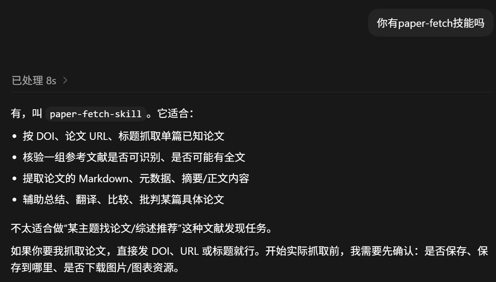
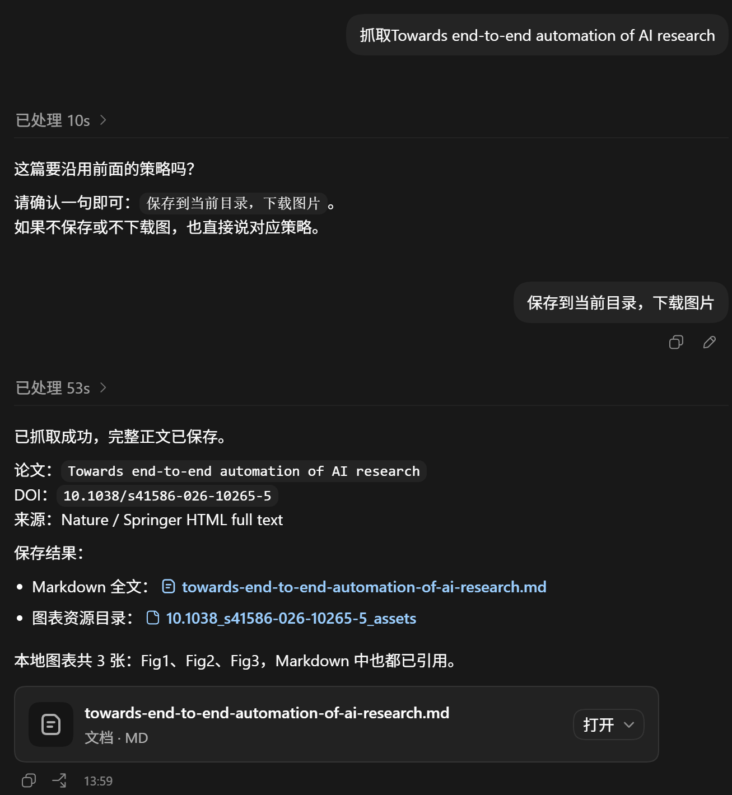
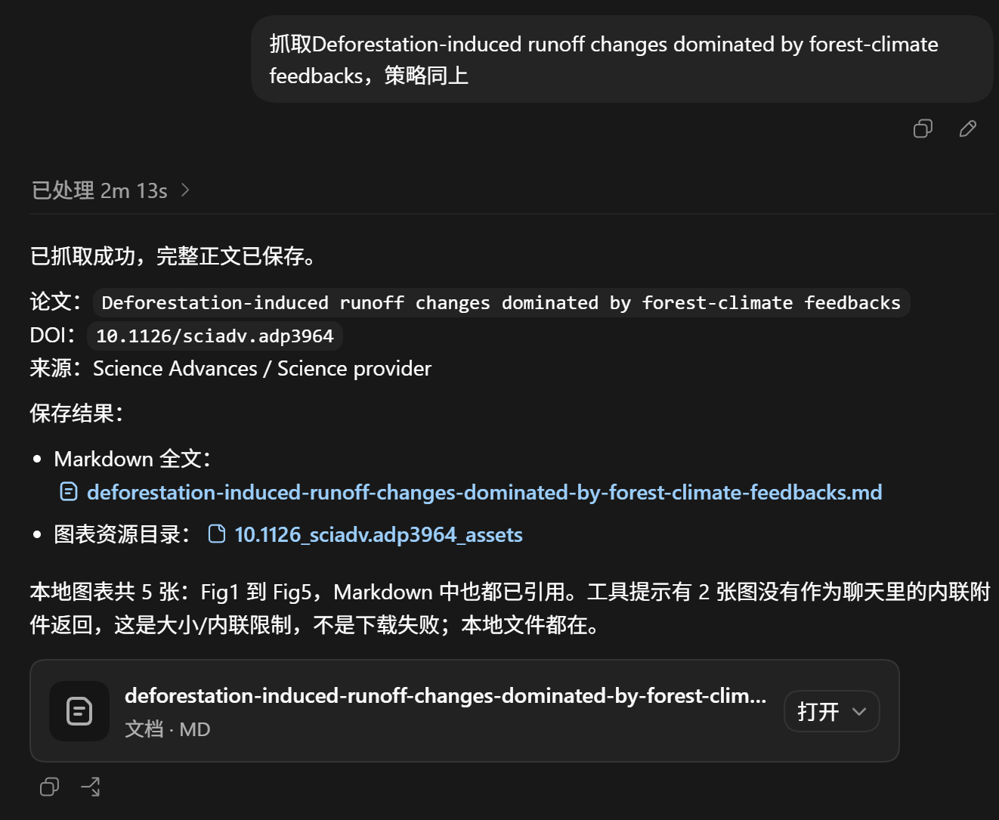

# Paper Fetch Skill

> Fetch papers as agent-ready markdown — DOI/URL/title in, structured full text out. CLI · Skill.

**Paper Fetch Skill** 是面向已知论文的 AI 阅读获取层：输入 DOI、论文/PubMed/PMC URL、arXiv ID、标题或引用条目，在你已有合法访问权限的范围内，返回结构化元数据、带受管 front matter 的 Markdown 全文、章节与图片位置索引以及可选图表/补充材料，让 Codex、Claude Code、Antigravity 等 Agent 从“只能读摘要”升级到“按需精读与核验全文”。

```text
DOI / URL / arXiv ID / title / citation
        ↓
身份解析与消歧 → 受支持 provider 的官方 HTML/XML → 验证后的 PDF fallback
        ↓
Sections · formulas · tables · references · local assets
        ↓
Markdown · section/image indexes · v2 JSON receipt & quality diagnostics
```

## 为什么不只是 PDF → Markdown

Paper Fetch 将论文身份解析、provider 路由、官方结构化全文与 PDF fallback 连接起来，并统一报告获取与内容质量。

| 维度 | Paper Fetch | 单一 PDF → Markdown 路径 |
| --- | --- | --- |
| 输入入口 | DOI、论文/PubMed/PMC URL、arXiv ID、标题或引用条目 | 已取得的 PDF |
| 首选内容源 | 受支持 provider 优先使用官方 HTML/XML，失败时再走验证后的 PDF fallback | PDF 文本层、版面和 OCR |
| 论文结构 | 统一交付 metadata、Markdown 正文、章节行号索引、图片位置索引与验收报告 | 取决于具体转换器及 PDF 版面 |
| 公式 | 源站提供 MathML/TeX 时转换并校验；失败时保留公式图片或缺失诊断 | PDF 公式恢复能力取决于具体转换器 |
| 图表与附件 | 支持随文归档、独立获取补充材料，或按阅读位置定向补取单张图片 | 图片导出和链接方式取决于具体转换器 |
| References | 全文/出版社 references 优先，保留 raw、DOI、标题和年份等可得字段 | 引用顺序和字段恢复取决于 PDF 版面与工具 |
| 质量可见性 | 区分获取状态、正文充分性、表格/公式语义损失与资产归档状态 | 诊断范围取决于具体转换器 |

## 安装与 Agent 接入

### 1. 官方离线安装包（推荐最终用户）

从 [GitHub Releases 最新稳定版](https://github.com/Dictation354/paper-fetch-skill/releases/latest) 下载对应平台的安装包。离线包已内置完整 Python 依赖、公式转换后端与独立 Node 运行时，并在安装时**自动为 Codex、Claude Code 和 Antigravity CLI 安装 Skill**：

- **Windows x64**：`paper-fetch-skill-windows-x86_64-setup.exe`（内置 CPython 3.14 运行时，无需预装 Python）
- **Linux x86_64**：`paper-fetch-skill-offline-linux-x86_64-cp311..cp314.sh`（需与本机标准 GIL CPython 3.11–3.14 版本匹配）
- **macOS 15+ Apple Silicon**：`paper-fetch-skill-offline-macos-arm64-cp311..cp314.tar.gz`（需与本机原生 arm64 CPython 3.11–3.14 版本匹配）

安装示例（Linux / macOS 请将 `cp312` 替换为本机对应的 Python 版本）：

```powershell
# Windows（PowerShell 或双击运行安装向导）
.\paper-fetch-skill-windows-x86_64-setup.exe
```

```bash
# Linux x86_64
chmod +x paper-fetch-skill-offline-linux-x86_64-cp312.sh
./paper-fetch-skill-offline-linux-x86_64-cp312.sh
```

```bash
# macOS 15+ Apple Silicon（若下载包带 quarantine 属性，核验 SHA256SUMS 后先执行 xattr -dr com.apple.quarantine <解压目录>）
tar -xzf paper-fetch-skill-offline-macos-arm64-cp312.tar.gz
cd paper-fetch-skill-offline-macos-arm64-cp312
./install-offline.sh
```

Linux / macOS 离线安装会创建受管的 `~/.local/bin/paper-fetch` 启动器并写入 shell 配置（当前终端也可执行 `source ~/.local/share/paper-fetch-skill/activate-offline.sh` 立即生效）。安装或更新后请重启已打开的 Agent 宿主。

**升级官方安装**：当最新正式 Release 提供当前平台安装包时，直接运行 `paper-fetch update`。Linux / macOS 自动校验并升级；Windows 下载校验后打开安装向导并预选当前安装目录；已是最新版时直接退出。

### 2. 源码安装与手动接入（Python ≥ 3.11）

在源码 checkout 中准备完整本地运行环境（含 `.venv`、`full` 依赖、配置骨架、受管浏览器准备及公式/图片转换后端），推荐使用顶层一键脚本：

```bash
./install.sh
```

仅需在现有 Python 环境中按需安装时，可选择 core（`.`）、`browser`、`pdf` 或 `full` 能力：

```bash
python -m pip install ".[full]"
paper-fetch-install-formula-tools   # 可选：安装本地 texmath / MathJax 公式后端
paper-fetch-install-image-tools     # 可选：检测/配置 Ghostscript 与 libvips 图片转换工具
```

源码方式安装后（离线安装包已自动注册，无需重复执行），可通过仓库脚本将静态 Skill 接入对应宿主（需确保 `paper-fetch` 已在宿主可见 `PATH` 中）：

| Host | 命令（默认 user scope，加 `--project` 为项目级） |
| --- | --- |
| Codex | `./scripts/install-codex-skill.sh` |
| Claude Code | `./scripts/install-claude-skill.sh` |
| Antigravity CLI | `./scripts/install-antigravity-skill.sh` |

离线包校验、Python ABI 约束、浏览器离线预置、macOS Gatekeeper/quarantine 处理及卸载流程见 [`docs/deployment.md`](docs/deployment.md)。

## 支持的出版社与数据源

运行时内置 **20 个内容 Provider** 及通用身份解析层（可通过 `paper-fetch doctor --catalog` 查看实时目录，详细路由 waterfall 与环境变量见 [`docs/providers.md`](docs/providers.md)）：

| 类别 | 支持的 Provider | 获取主路径与说明 |
| --- | --- | --- |
| 开放获取直连（无需浏览器） | `arxiv`、`plos`、`frontiers`、`copernicus` | 优先使用官方 HTML 或 JATS/NLM XML（`arxiv` 优先匹配 e-print 源图并补充 Atom 元数据），不可用时回退直连 PDF |
| API / 直连与浏览器协同 | `elsevier`、`springer`、`oxfordacademic`、`ieee` | `elsevier`（ScienceDirect）支持官方 XML/PDF API 与浏览器双路线；`springer`（含 Nature / SpringerLink / BMC）与 `oxfordacademic` 走直连 HTML/PDF；`ieee` 先走直连/REST，受阻时切换受管浏览器 |
| 受管浏览器优先 | `wiley`、`science`、`pnas`、`acs`、`rsc`、`iop`、`aip`、`tandf`、`royalsocietypublishing`、`annualreviews`、`mdpi`、`ams` | 优先捕获经就绪校验的出版社 HTML，失败时回退同会话浏览器 PDF/ePDF（`wiley` 另支持 TDM API PDF；`ams` 联网前需先完成一次 `paper-fetch auth ams` 验证） |
| 身份解析与元数据兜底 | `crossref`（含 PubMed / PMC 链接解析） | 负责 DOI/标题消歧、PubMed 与 PMC 链接识别、出版社路由信号及无全文时的元数据兜底 |

## CLI 命令与任务预设

### 9 个 CLI 子命令

| 命令 | 用途 |
| --- | --- |
| `fetch` | 单篇或 `--query-file` 批量抓取论文正文、归档资产或独立获取补充材料 |
| `lookup` | 按单个 `--doi` 或 `--query-file` 在指定输出目录中只读查找已验收全文（`--include-legacy` 可回退历史结果） |
| `fetch-assets` | 按已有 `--manifest`（或 `--query`）配合 `--asset-id`、`--asset-url` 或 `--kind {formula,figure,table}` 定向补取图片，无需重抓全文 |
| `resolve` | 独立执行论文身份解析与候选消歧（支持单篇与批量） |
| `check` | 仅探测全文可用性，不下载正文（支持单篇与批量） |
| `doctor` | 本地无网络静态诊断，检查配置来源、浏览器与图片工具依赖及 `--catalog` |
| `browser-preflight` | 实际启动浏览器访问指定（或全部）浏览器 provider 示例页，验证可达性与环境健康度 |
| `auth` | 打开有头浏览器完成人工登录/机构认证，保存至原生持久 profile |
| `update` | 检查、校验并升级官方 GitHub Release 安装包 |

### 5 类任务预设与工作流

`fetch` 的 `--preset` 仅补全未显式传入的参数，显式命令行选项始终优先（完整矩阵见 [`presets.md`](skills/paper-fetch-skill/references/presets.md) 与 [`docs/cli.md`](docs/cli.md)）：

- **`temporary_read`（`fetch` 默认）**：将完整正文、回执、章节与图片索引及诊断保存到独立的系统临时目录（退出后保留），不读写持久缓存、不下载正文图片，适合一次性阅读。
- **`cacheable_read`**：配合 `--output-dir`，优先复用目录内合格的 v8 指纹缓存并保存新结果，默认仍不下载图片，适合同一项目内跨会话阅读。
- **`archive`**：配合 `--output-dir` 本地归档并启用缓存复用；需保存正文图表时加 `--asset-profile body`，连同补充材料一起归档用 `--asset-profile all`。
- **批量可读性分诊**：使用 `paper-fetch check --query-file ...` 预先筛选一批条目的全文可用性。
- **批量本地归档**：使用 `paper-fetch fetch --preset archive --query-file ... --output-dir ...` 批量抓取并按输入顺序生成 `batch-results.jsonl`。

## 常用命令示例

### 1. 临时阅读与按需补图

```bash
# 默认 temporary_read：保存正文快照与索引至系统临时目录，stdout 返回 v2 JSON 回执
paper-fetch fetch --query "10.1186/1471-2105-11-421"

# 阅读到需要核对的公式图、插图或表格图时，凭逐篇 manifest 定向补取
paper-fetch fetch-assets --compact --manifest /absolute/path/to/manifest.json --kind figure
```

若只需把 Markdown 正文直接流式输出到终端 stdout（回执仍自动保存在系统临时目录）：

```bash
paper-fetch fetch --query "10.1186/1471-2105-11-421" --output -
```

### 2. 本地归档与已有全文复用

```bash
# 归档单篇论文及正文图片，并写入可复用缓存
paper-fetch fetch \
  --preset archive \
  --query "10.1038/s41586-026-10265-5" \
  --output-dir ./papers \
  --asset-profile body

# 在一个或多个项目目录中按 DOI 查找已验收全文，命中直接返回 v2 回执，避免重复联网
paper-fetch lookup --doi "10.1038/s41586-026-10265-5" --output-dir ./papers
```

### 3. 批量探测与批量归档

准备每行一个查询（DOI、URL 或标题）的 UTF-8 文本文件 `queries.txt`：

```bash
# 仅探测可用性（不下载正文）
paper-fetch check --query-file ./queries.txt --batch-concurrency 4

# 批量抓取与归档（1–8 并发，单篇失败不阻塞其余条目，按输入顺序原子写出 batch-results.jsonl）
paper-fetch fetch \
  --preset archive \
  --query-file ./queries.txt \
  --output-dir ./papers \
  --batch-concurrency 4
```

### 4. 独立获取补充材料

```bash
paper-fetch fetch \
  --target supplementary \
  --preset archive \
  --query "10.1038/s41561-022-00912-7" \
  --output-dir ./papers
```

只需要补充附件、Source Data、Extended Data 或多媒体时，使用 `--target supplementary`（默认启用 `asset_profile=all` 与 `artifact_mode=markdown-assets`），无需先取得正文，也不下载正文 PDF。随正文一并获取补充材料则保持默认 `--target paper` 并传 `--asset-profile all`，详见 [独立补充材料任务](docs/cli.md#独立补充材料任务)。

> **实时进度与协作取消**：CLI 默认在终端 `stderr` 显示文本进度；可通过 `--progress text|jsonl|none` 显式控制，或使用 `--progress jsonl --control-stdin` 按 `run_id/index` 发起单篇/整批机器取消，详见 [`docs/cli.md`](docs/cli.md#实时进度与机器取消)。

## 输出契约与交付产物

- **带受管 YAML front matter 的论文 Markdown**：记录 `title`、`authors`、`journal`、`doi`、`publication_dates`、`source`、`acquisition`（`provider`/`route`/`representation`/`transport`/`fallback_used`）及 `has_fulltext`、`content_kind`、`has_abstract`、`token_estimate`；正文按源结构恢复摘要、章节、表格、公式、figure caption 和 references。
- **版本化紧凑回执（`paper-fetch/receipt`，`schema_version=2`）**：每条请求进入终态时均在 `.paper-fetch-results/<run_id>/<index>/receipt.json` 原子保存（`--output -` 时同样保留），顶层提供论文身份、`status`、`target_satisfied`、七分面 `acceptance`、`body_path`、`section_index_path`、`image_index_path`、`manifest_path`、`diagnostic_paths` 及稳定原因码。取得全文（含降级全文）退出 `0`，仅摘要/元数据或失败退出 `1`，参数错误退出 `2`。
- **章节与图片位置索引**：`sections.json` 提供从 `1` 起算的正文行号范围（供按章定位精读）；`images.json` 记录图片候选及 Markdown 正文内的 `{line, column}` 位置 `body_positions`（供按阅读段落调用 `fetch-assets` 补图）。
- **逐篇 `manifest.json`（schema v3）与脱敏诊断**：完整保留请求参数、验收详情、各阶段耗时 `trace` 与脱敏错误上下文。

项目面向使用者与宿主提供两个主要入口（Python 包亦导出 `fetch_paper`、`resolve_paper` 等底层编程接口供库集成）：

| 入口 | 适用场景 |
| --- | --- |
| `paper-fetch` CLI | 单篇/批量抓取、项目全文查找、按需补图、环境诊断与登录态管理 |
| `skills/paper-fetch-skill/` | 指导 Agent 优先复用本地结果、按意图选择命令与预设、分段精读并核验交付质量 |

## 效果展示

Agent 安装 Skill 后，可以识别 Paper Fetch 的适用边界，按用户意图选择复用、临时阅读、归档或探测，并核验实际正文和资产。



以下示例来自真实开放获取论文抓取产物（注：演示截图与静态示例生成自早期版本，现行版本的 front matter 与回执字段以上方输出契约为准）。

### Nature 示例

- 论文：Towards end-to-end automation of AI research
- DOI：`10.1038/s41586-026-10265-5`
- 来源：Springer/Nature HTML full text
- 许可：[`CC BY 4.0`](https://creativecommons.org/licenses/by/4.0)
- Markdown 全文：[`towards-end-to-end-automation-of-ai-research.md`](figures/towards-end-to-end-automation-of-ai-research.md)



### Science Advances 示例

- 论文：Deforestation-induced runoff changes dominated by forest-climate feedbacks
- DOI：`10.1126/sciadv.adp3964`
- 来源：Science Advances / Science provider
- Markdown 全文：[`deforestation-induced-runoff-changes-dominated-by-forest-climate-feedbacks.md`](figures/deforestation-induced-runoff-changes-dominated-by-forest-climate-feedbacks.md)



## 访问权限与运行时

Paper Fetch 不绕过付费墙、订阅授权或反爬验证码。实际可获取范围取决于目标 provider、用户凭据、机构网络权限与本机运行环境：

- **官方 API 凭据**：Elsevier XML/PDF API 路线使用从 <https://dev.elsevier.com/> 申请的 `ELSEVIER_API_KEY`（ScienceDirect 浏览器路线独立使用浏览器访问状态，API key 不赋予浏览器权限）；Wiley 可选配置 `WILEY_TDM_CLIENT_TOKEN` 启用官方 TDM PDF 通道。
- **受管浏览器运行时**：所有浏览器路线统一经受管 Byparr 调度（Windows / Linux x64 使用 InvisiblePlaywright，macOS / ARM 使用 Camoufox），认证、预检与抓取共用 `publisher-browser-profiles/<provider>/` 原生持久目录。安装器默认准备当前平台支持的浏览器，跳过、离线预置与重试命令见 [部署指南](docs/deployment.md#浏览器安装与准备)。
- **AMS 认证要求**：AMS 正文、补充材料与定向补图的联网请求要求已完成一次 `paper-fetch auth ams` 验证（交互式 CLI 缺少状态时会引导认证后继续，非交互环境返回 `auth_required`）。
- **静态诊断、预检与人工认证**：`doctor` 仅做本地无网络检查；`browser-preflight` 会实际启动浏览器访问页面（建议用 `--provider` 指定目标出版社，省略时将串行预检全部浏览器 provider）；需要建立或更新机构登录态时运行 `auth`：

```bash
paper-fetch doctor
paper-fetch browser-preflight --provider wiley
paper-fetch auth wiley
```

浏览器后端、持久目录协调与平台限制见 [`docs/browser-runtime.md`](docs/browser-runtime.md) 与 [`docs/browser-backends.md`](docs/browser-backends.md)；各 provider 的详细能力与配置项见 [`docs/providers.md`](docs/providers.md)。

## 项目边界

- 只负责已知论文的身份解析、全文与补充材料获取、统一验收和报告，不替代开放式主题检索、文献推荐或综述生成。
- 结构化公式转换依赖源站提供 MathML/TeX；源站仅提供图片或 PDF 排版信息时，不承诺恢复可靠 LaTeX。
- PDF 转换输出以现有 `pymupdf4llm` 结果为边界原样透传，不做格式清洗或内容修复，见 [PDF 转换边界](docs/extraction-rules.md#rule-pdf-conversion-boundary)。

## 文档导航

- [`docs/cli.md`](docs/cli.md)：CLI 命令、回执/manifest 契约、批量抓取、补图与错误码。
- [`docs/deployment.md`](docs/deployment.md)：离线安装包、源码部署、配置文件、Skill 接入与升级卸载。
- [`docs/providers.md`](docs/providers.md)：20 个内容 provider 的路由、能力矩阵、环境变量与缓存语义。
- [`docs/browser-runtime.md`](docs/browser-runtime.md) / [`docs/browser-backends.md`](docs/browser-backends.md)：受管 Byparr 运行时、原生登录态目录与预检边界。
- [`docs/README.md`](docs/README.md)：完整文档导航与事实来源索引。
- [`docs/architecture/overview.md`](docs/architecture/overview.md) / [`docs/adding-a-provider.md`](docs/adding-a-provider.md)：架构边界与新增 provider 开发指南。
- [`CHANGELOG_CN.md`](CHANGELOG_CN.md) / [`CHANGELOG.md`](CHANGELOG.md)：中英文版本更新日志。

## 许可证与免责声明

- **代码开源许可**：本项目源代码基于 [MIT License](LICENSE) 开源发布（离线安装包随附第三方组件的许可证见包内清单）。
- **文献获取与样本免责声明**：
  - 获取的文献仅供个人学术研究和学习使用，不得用于商业用途。
  - 请遵守所在国家/地区著作权法律法规及所在机构的知识产权与合理使用政策。
  - 抓取结果、资产和缓存按所选参数保存在本地；仓库中的示例与测试样本仅用于展示和回归验证。
  - `tests/fixtures/` 中的文献样本仅作为测试证据使用，严禁对其进行任何形式的二次分发。
  - 使用者应对自身的文献获取和使用行为承担全部责任。
