# Harnessing diffraction with metamaterial noise barriers for enhanced sound attenuation

## Abstract

Wave diffraction is typically regarded as a limiting factor in the performance of acoustic noise barriers, enabling sound to bend over finite structures and reducing attenuation, particularly at low frequencies. In this work, we demonstrate that diffraction can instead be harnessed as a functional mechanism for sound suppression by designing metamaterial barriers that incorporate a vertical array of resonators along the barrier surface. The proposed structure changes the dispersion characteristics of edge-diffracted waves and acts as a boundary that transforms diffraction into surface-guided wave propagation. Our analysis reveals that the metabarrier achieves broadband sound attenuation through two distinct mechanisms: (i) the formation of strong standing wave modes due to surface-guided waves confined along the barrier face, and (ii) resonance-induced evanescence decay resulting in localized band gap formation. Together, these effects lead to a substantial enhancement in insertion loss over a broad frequency range. Furthermore, we show that performance can be tuned by implementing double-sided arrays. These findings introduce a new framework for acoustic wave control, in which diffraction is not merely mitigated but actively exploited as a design-enabling feature.

## Visual Abstract

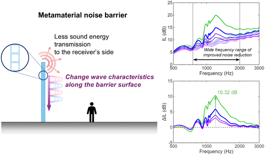

We introduce a metabarrier that exploits, rather than suppresses, diffraction. A vertical resonator array converts diffracted sound into surface-guided waves, achieving broadband noise attenuation and redefining diffraction as a functional mechanism.

### New concepts

Diffraction is conventionally regarded as a limiting factor for noise barrier performance, as it allows sound to bend over finite structures. In this work, we introduce the concept of a *metabarrier* that transforms diffraction from a detrimental effect into a functional mechanism for sound suppression. By integrating a vertical array of resonators into the barrier face, diffraction is harnessed to generate surface-guided waves that enhance sound attenuation across a broad frequency range. This approach establishes a new paradigm for acoustic metamaterials—one that exploits, rather than suppresses, diffraction as a means of controlling wave propagation.

## 1 Introduction

Unwanted noise from sources such as road traffic, railway lines, construction activity, and industrial operations presents a persistent challenge in both public and occupational environments. Prolonged exposure to elevated noise levels has been linked to serious health issues, including hearing impairment, cardiovascular disease, and increased stress.1,2 To reduce these risks, noise barriers—also referred to as acoustic screens—are widely employed to shield noise-sensitive areas. These barriers function by obstructing the direct path of sound propagation between the source and the receiver, thereby providing passive attenuation in open or semi-enclosed settings.3

However, due to their open-top configuration, the noise reduction performance of barriers is often limited by edge diffraction. When the barrier height is finite—as is always the case in practice—incident sound waves bend over the upper edge and propagate into the shadow zone through diffraction, as illustrated in Fig. 1(a). This phenomenon becomes the dominant noise transmission mechanism, particularly at low frequencies. To mitigate this effect, various geometric modifications have been proposed to suppress diffracted waves, such as adding T- or Y-shaped extensions,4–6 curved overhangs,7,8 or serrated caps9 at the barrier top. Other strategies focus on optimizing barrier geometry10,11 or the spatial distribution of absorbing materials.12,13 While these strategies provide some improvements, they remain fundamentally constrained by the physics of diffraction.

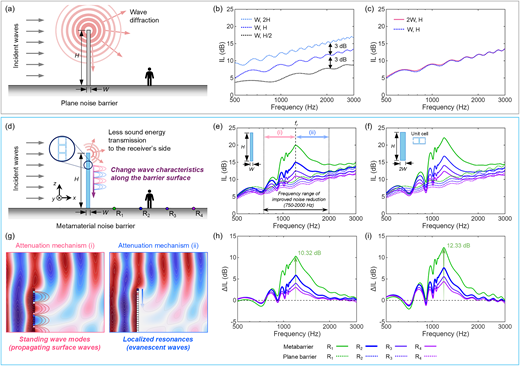

**Fig. 1** Concept and performance comparison between conventional and metamaterial-based noise barriers (metabarriers). (a) Schematic illustration of a conventional plane noise barrier, where incident waves are diffracted around the top edge. (b, c) Insertion loss (IL) of plane barriers with varying heights and widths, respectively. Increasing barrier height enhances IL by only 3 dB, while increasing width provides negligible improvement. (d) Schematic illustration of the proposed metabarrier, consisting of vertically stacked Helmholtz resonators integrated along the barrier face, which modify the wave characteristics along the surface and reduce transmitted sound energy. (e) IL spectra of the metabarrier for different receiver positions (R1–R4) at distances of *H*/2, *H*, 3<em>H</em>/2, and 2<em>H</em> from the barrier, respectively. The metabarrier exhibits enhanced attenuation not only at the resonant frequency (*f*r ≈ 1200 Hz) but also over a broad frequency range (750–2000 Hz). (f) IL spectra for a dual-sided metabarrier configuration (resonators on both faces), showing further enhancement in IL compared to the single-sided design. (g) Visualization of the two attenuation mechanisms: (i) formation of standing wave modes due to propagating surface waves and (ii) localized resonances producing evanescent wave decay. (h, i) Difference in insertion loss (ΔIL) between metabarriers and plane barriers for single- and dual-sided configurations, respectively.

In recent decades, the emergence of sonic crystals and acoustic metamaterials has introduced a new paradigm in wave control, enabling unprecedented capabilities for reducing low-frequency noise using compact, subwavelength-scale structures.14–17 This paradigm shift has also inspired a reimagining of noise barrier design through the integration of metamaterial principles. A primary focus has been on utilizing band gaps in periodically arranged unit cells. Rigid or porous cylinders,18–22 microperforated cylindrical shells,23,24 and Helmholtz resonators25–28 were employed as the periodic unit cells. These designs effectively attenuate sound within the designated band gaps; however, their efficacy is inherently limited to these specific frequency ranges, thereby permitting the transmission of sound outside the band gaps, resulting in a limited overall broadband noise reduction. Furthermore, effective utilization of band gaps requires at least three periodic units along the direction of wave propagation, imposing substantial spatial constraints on practical implementations. These limitations highlight the need for a new approach that more effectively merges the principles of metamaterials with the practical constraints of noise barrier design.

In this work, we propose and investigate a new class of metamaterial-based noise barrier—hereafter referred to as a metabarrier—which consists of vertically stacked periodic resonators integrated into the barrier face. Unlike conventional barrier enhancements that aim to suppress edge diffraction by altering the barrier geometry, our design intentionally preserves the standard barrier form and allows diffracted waves to develop naturally. The key concept is to exploit diffraction by transforming the resulting edge-diffracted waves into strongly dispersive surface-guided waves along the structured interface created by the resonator array. At low frequencies, these waves propagate with a reduced phase and group velocity, while approaching cutoff near the resonant frequency of the unit cells.29–33 By tuning this dispersion behavior, acoustic energy that would normally leak into the shadow zone is instead slowed, confined, and attenuated along the barrier surface.

To implement this concept in a compact and tunable manner, we employ subwavelength Helmholtz-type resonators, as illustrated in Fig. 1(d), which offer well-defined dispersion properties and straightforward geometric tailoring, as extensively demonstrated in acoustic metamaterial research from early developments34,35 to recent advances.36–39 We show that the metabarrier achieves broadband noise reduction, with enhanced attenuation in sub-resonant regimes due to intensified standing surface-wave modes along the barrier height, and sharp attenuation near resonance resulting from evanescence decay. Moreover, these attenuation mechanisms can be further strengthened by employing resonant structures on both sides of the barrier. Experimental validation of the proposed design is also provided.

The key innovation of this work lies in two main aspects: (i) the harnessing of wave diffraction—an unconventional and, to our knowledge, a novel approach, given that diffraction is typically associated with reduction of the performance of noise barriers—and (ii) the effective utilization of the entire structure of the acoustic system (*i.e.*, barrier height), rather than relying solely on the thickness or resonant behavior of individual unit elements. The underlying physics established in this study can be readily extended to other metamaterial structures incorporating resonant elements, such as coiled-up resonators40,41 and membrane resonators.33,42,43

## 2 Insertion loss by metabarriers

The effectiveness of noise barriers is commonly quantified by insertion loss (IL) defined as follows:

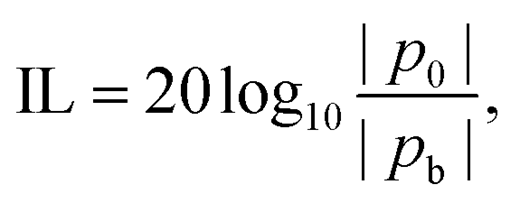 (1)

where *p*b and *p*0 represent the sound pressures at a receiver position with and without the presence of the noise barrier, respectively. Higher insertion loss indicates higher sound attenuation due to the presence of the barrier. To calculate insertion loss, we conducted numerical simulations using the commercial FEM solver, COMSOL Multiphysics 6.3.44 Detailed information about the simulation setup is provided in Section S1, SI. The barrier structures were assumed to be acoustically rigid. Although structural responses can affect acoustic performance, their influence was found to be negligible in this study (see Section S2, SI).

Fig. 1(b) and (c) compare the insertion loss of conventional planar noise barriers with varying heights and widths. As expected, the IL generally increases with frequency since the influence of wave diffraction diminishes at higher frequencies. In practical designs, improving performance often involves increasing the barrier height or width. However, as shown in Fig. 1(b), doubling the barrier height enhances the insertion loss by only about 3 dB, while doubling the barrier width yields virtually no improvement, as illustrated in Fig. 1(c).

However, by employing the concept of a metabarrier, the acoustic performance within a targeted frequency range can be significantly enhanced without increasing the barrier's height or width. Let us consider a metabarrier consisting of *N* Helmholtz resonators with square cross-sections, stacked vertically along the *z* direction, all tuned to the same resonance frequency. In our specific model, a total of 20 resonators are used. Each resonator has a side length *d* of 25 mm, and the thickness of the resonator walls *t*p is 2 mm, resulting in an internal cavity side length *d*i of 21 mm. The width of the resonator opening *a* is 1 mm. These geometric parameters yield a resonance frequency around 1200 Hz. For the resonator array considered, the width of the metabarrier equals the width of the resonator (*W* = *d* = 25 mm), and the total height of the barrier is the height of one resonator multiplied by the number of resonators (*H* = *Nd* = 0.5 m).

The plane-wave excitation conditions and the barrier size adopted in this work were selected to ensure consistency with the experimental validation presented in Section 5. In practical noise-barrier applications, however, sound sources are more realistically represented by near-ground monopole sources, and the barriers typically have much larger dimensions. We note that the sound attenuation mechanisms of the proposed metabarrier remain effective under monopole source excitation and when the structure is scaled up to realistic dimensions. Numerical simulation results for monopole source excitation are presented in Section S3, while simulations demonstrating the scalability of the metabarrier to larger barrier dimensions are provided in Section S4 of the SI.

Fig. 1(e) shows the insertion loss of the metabarrier over the frequency range of 500–3000 Hz, calculated with a frequency resolution of 1 Hz. The insertion loss varies with the receiver position: receivers located closer to the barrier experience higher attenuation, which gradually decreases with increasing distance. These calculations were performed for receivers positioned at distances of 0.25 m (R1), 0.50 m (R2), 0.75 m (R3), and 1.00 m (R4) from the barrier. For comparison, the insertion loss values of a nominal plane barrier with the same width and height as those of the metabarrier are also shown in dotted lines. Fig. 1(h) depicts the differences in insertion loss (ΔIL) between the metabarrier and the plane barrier. For all receiver locations, the highest peak in insertion loss occurs around 1200 Hz, which corresponds to the resonance frequency of the individual Helmholtz resonator unit (*f*r). At the closest receiver position (R1), the metabarrier achieves a maximum IL increase of 10.28 dB at the peak frequency compared to the plane barrier. This improvement is substantial, especially considering that doubling the height of a conventional noise barrier typically yields only about a 3 dB increase in insertion loss.

In addition, the results show that the metabarrier enhances sound attenuation not only at the resonance frequency but also across a broad frequency range from 750 to 2000 Hz, as illustrated in Fig. 1(e). While noise reduction at resonance frequencies is commonly expected when resonators are employed in noise control systems, the observed broadband attenuation extending both below and above the resonance frequency is notably uncommon. As will be discussed in detail in the following section, this broadband enhancement arises from two distinct mechanisms. Below the resonance frequency (highlighted by the pink arrow in Fig. 1(e)), the attenuation results from intensified standing wave modes formed by surface-guided waves along the barrier face (see Fig. 1(g), left panel). Above the resonance frequency (indicated by the blue arrow in Fig. 1(e)), the attenuation is attributed to evanescence decay associated with a resonance-induced band gap (see Fig. 1(g), right panel). Compared with several recently reported resonator-based metamaterial designs, the present metabarrier achieves a relatively broad effective attenuation bandwidth for its compact structural thickness (see the SI, Section S5).

The metabarrier configuration used for the results in Fig. 1(e) and (h) consists of a single array of resonators on one side of the barrier. When an additional array of resonators is introduced on the opposite side (increasing the total width to 2<em>W</em>), the diffraction-assisted attenuation mechanism becomes even stronger. As shown in Fig. 1(f) and (i), this dual-sided configuration achieves higher insertion loss values simply by utilizing both faces of the barrier. This finding is particularly noteworthy when compared with the results in Fig. 1(c), where doubling the width of a planar barrier yields no improvement.

In the following sections, we will explore the underlying mechanisms responsible for this enhanced noise reduction in detail.

## 3 Sound attenuation mechanism

### 3.1 Surface waves over periodic resonators

When a sound wave travels along a periodic structure composed of resonator units, a guided mode is generated on the surface.29–33 When the size of the resonator unit is much smaller than the wavelength of the sound waves, the dispersion relation of this guided mode can be derived using the theory of effective impedance boundaries.29,30 Consider a periodic array of Helmholtz resonators, as shown in Fig. 2(a). The pressure and the *x*-component of velocity of the guided surface wave propagating over the periodic resonators along the negative *z* direction can be expressed as follows:

*p*(*x*,*z*) = *p*0e−<em>k</em><em>x</em><em>x</em>e<em>i</em>(−<em>k</em><em>z</em>−<em>ωt</em>), (2)

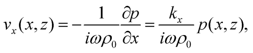 (3)

where *p*0 is an arbitrary amplitude, *k*<em>x</em> and *k*<em>z</em> are the *x* and *z* components of the wavenumber, respectively, *ω* is the angular frequency, and *ρ*0 is the mass density of air. Using these equations, the surface impedance *Z*<em>s</em> at *x* = 0 is described as follows:

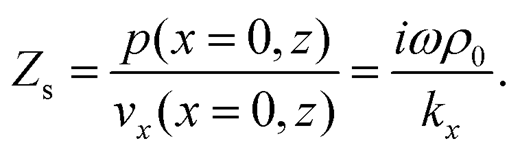 (4)

The surface impedance in eqn (4) should match the surface impedance of the Helmholtz resonator array *Z*HR at *x* = 0, which can be written as follows:45

*Z*HR = *iωm*eff − *iρ*0*c*0 cot(*k*0*d*<em>i</em>), (5)

with the effective acoustic mass of the resonator *m*eff defined as follows:

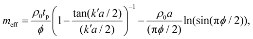 (6)

where *c*0 is the speed of sound in air, *ϕ* is the ratio of the neck width to the resonator width (*a*/*d*), and 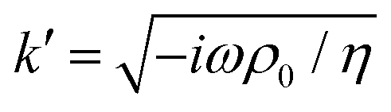 with *η* being the viscosity of air. Combining eqn (4) and (5), and using the relation *k*<em>x</em>2+ *k*<em>z</em>2 = *k*02, gives the dispersion relation of the surface waves

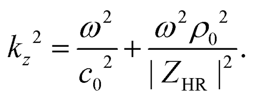 (7)

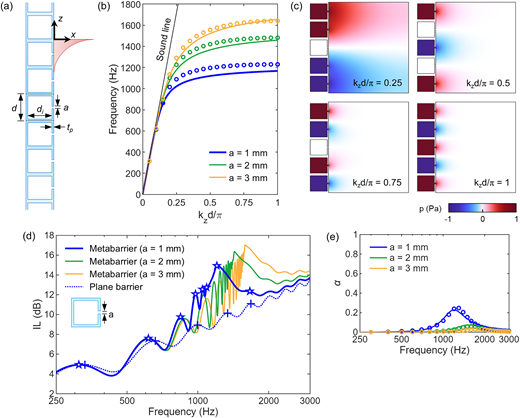

**Fig. 2** (a) Helmholtz resonators are periodically placed along the *z* direction. (b) Dispersion curves for different Helmholtz resonator neck widths *a* = 1 mm, 2 mm, and 3 mm. Solid lines denote the theoretical calculation results and circles denote numerical simulation results. (c) Acoustic pressure fields at frequencies corresponding to *k*<em>z</em>*d*/π = 0.25, 0.5, 0.75, and 1, when *a* = 1 mm. (d) Insertion losses by metabarriers with different resonator neck widths (*a* = 1 mm, 2 mm, and 3 mm) compared to a plane barrier. All insertion loss values are calculated at the receiver position R2. (e) Normal-incidence sound absorption coefficients of Helmholtz resonators with varying neck widths (*a* = 1 mm, 2 mm, and 3 mm). Solid lines indicate analytical results obtained using the impedance model in eqn (5), while circles indicate numerical simulation results. Analytical absorption coefficients were calculated as *α* = 1 − |*R*|2, where the normal-incidence reflection coefficient is given by *R* = (*Z*HR−*z*0)/(*Z*HR+*z*0).

Fig. 2(b) shows the dispersion curves of the surface waves propagating along the periodic Helmholtz resonators, calculated using the theoretical model in eqn (7) (solid lines) and numerical simulations (circle markers) for different resonator neck widths: *a* = 1 mm, 2 mm, and 3 mm. The straight black solid line indicates the sound line, *i.e.*, the dispersion of the bulk wave in air. For small values of *k*<em>z</em>, the dispersion of the surface waves follows that of the sound line; however, with the increase in *k*<em>z</em>, the frequency converges to the resonance frequency of the Helmholtz resonator. Note that dissipation in the resonator neck was not included in the numerical simulations; thus, the resonance frequencies slightly differ from the theoretical prediction. Fig. 2(c) shows the mode shapes (sound pressure distribution) of the surface waves at *k*<em>z</em>*d*/π = 0.25, 0.5, 0.75, and 1, for the resonator neck width of 1 mm. These mode shapes demonstrate that the sound fields are confined near the surface of the resonators. In these surface-wave modes, the waves propagate slower, and the group velocity (*c*g = d<em>ω</em>/d<em>k</em><em>z</em>) eventually reaches zero as the frequency approaches the resonance frequency of the resonator. This implies that the waves propagate at a velocity slower than the speed of sound in air for frequencies below the resonance frequency, becoming increasingly confined as they approach resonance.

### 3.2 Wave diffraction over a noise barrier

The influence of surface waves as elaborated in Section 3.1 on the sound attenuation mechanism may not be immediately apparent. To fully understand this, it is necessary to examine the wave behavior around a plane noise barrier. When sound waves encounter discontinuities in the medium, diffraction occurs. In the case of a noise barrier, the barrier acts as an obstacle, causing the incident sound waves to bend around its edges. This generates diffracted waves, with the top edge of the barrier effectively acting as a new source of sound waves. These diffracted waves then interact with other waves in the environment, particularly those reflected from the ground surface. The interaction between the diffracted and reflected waves generates interference patterns, forming harmonic standing wave patterns along the barrier in the vertical (*z*) direction.

These standing waves influence the sound attenuation performance of a plane barrier, which causes small peaks and troughs in the IL curve. At frequencies where the multiples of the half-wavelength coincide with the height of the barrier, *i.e.*, *H* ≈ *nλ*/2 where *n* is an integer, the insertion loss slightly increases. Conversely, at frequencies where the odd multiples of the half-wavelength coincide with the height of the barrier, the insertion loss slightly decreases. The dotted line in Fig. 2(d) presents the insertion loss of the plane barrier calculated at the receiver position R2 (*i.e.*, 0.5 m away from the barrier). The frequencies of the peaks indicated with ‘+’ markers are 331 Hz, 660 Hz, 999 Hz, 1340 Hz, and 1682 Hz. The wavelengths of the sound waves at these frequencies are 1.0363 m, 0.5197 m, 0.3433 m, 0.2560 m, and 0.2039 m, respectively (sound velocity in air *c*0 = 343 m s−1). Comparing these wavelengths with the height of the barrier *H* (= 0.5 m) gives 2.0725 *H*, 1.0394 *H*, 0.6867 *H*, 0.5119 *H*, and 0.4078 *H*, which are approximately 2 *H*, *H*, 2/3 *H*, 1/2 *H*, and 2/5 *H*, confirming the relationship between the half wavelength and the height of the noise barrier for the generation of standing wave modes. Revisiting Fig. 1(b), it can be observed that the frequency spacing between neighboring IL peaks decreases as the barrier height increases, consistent with the relation between standing wave modes and barrier height. In contrast, changing the barrier width (Fig. 1(c)) results in only slight shifts in the peak and trough frequencies, indicating a minor influence on the standing wave behavior.

The standing wave behavior can also be visualized through the wave fields around the plane barrier. Fig. 3(a)–(h) show the pressure (top figures) and velocity fields (bottom figures) at the peak frequencies indicated in Fig. 2(d). The yellow arrows in Fig. 3(a) indicate the propagation direction of the incident plane waves. It is noticeable that there are areas of constructive and destructive interference along the vertical direction of the barrier. The graphs in Fig. 3(i) show the pressure and velocity magnitudes calculated on the right-hand side surface of the barrier at the peak frequencies. It is clearly observable that there is a relation between the half-wavelength and the height of the noise barrier. Note that near the top of the noise barrier, the pressures and velocities do not form perfect sine or cosine patterns. This is the result of the standing waves interfering with the waves propagating in the +*x* direction over the barrier.

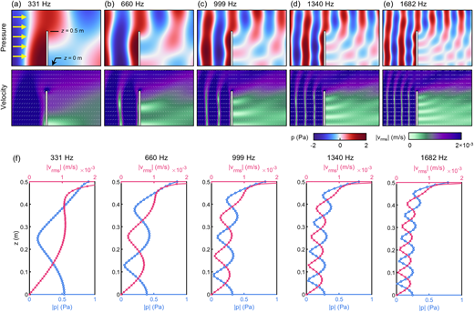

**Fig. 3** Pressure and velocity fields around a plane noise barrier at the peak frequencies marked in Fig. 2(d): (a) 331 Hz, (b) 660 Hz, (c) 999 Hz, (d) 1340 Hz, and (e) 1682 Hz. The yellow arrows in (a) indicate wave incidence direction, while the white arrows in velocity fields indicate the direction of velocity vectors. (f) The magnitude of pressures and velocities calculated along the right-hand side surface of the barrier at the peak frequencies.

### 3.3 Sound attenuation mechanism of the metabarrier

The sound waves around the metabarrier have the combined characteristics of the wave phenomena explained in Sections 3.1 and 3.2. To explicitly demonstrate these, the wave fields around the metabarrier at the eight peak frequencies indicated with star markers in Fig. 2(d) are presented in Fig. 4. Fig. 4(a)–(h) show the pressure and velocity fields around the metabarrier, while Fig. 4(i) shows the magnitude of pressures and velocities along the right-hand side of the metabarrier. Due to the discontinuities of the geometry presented by the resonator openings, the pressures and velocities shown in Fig. 4(i) are extracted from a vertical line displaced 10 mm from the surface of the barrier.

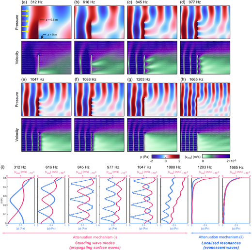

**Fig. 4** Pressure and velocity fields around the metabarrier at the peak frequencies marked in Fig. 2(d): (a) 312 Hz, (b) 616 Hz, (c) 845 Hz, (d) 977 Hz, (e) 1047 Hz, (f) 1088 Hz, (g) 1203 Hz, and (h) 1665 Hz. The yellow arrows in (a) indicate wave incidence direction, while the white arrows in the velocity fields indicate the direction of velocity vectors. (i) The magnitude of pressures and velocities calculated along the right-hand side surface of the barrier at the peak frequencies.

The first two peak frequencies of the metabarrier, 312 Hz and 616 Hz, closely resemble the first two peak frequencies of the plane barrier, 331 Hz and 660 Hz. The IL values (see Fig. 2(d)), wave fields around the two barriers, and pressure and velocity patterns on the right-hand side surface, show similar behavior. However, from the third peak frequency (845 Hz), the ILs by the metabarrier start to behave differently with respect to the plane barrier: The IL peaks of the metabarrier become higher and more condensed with increasing frequency until the highest peak is reached at 1203 Hz, while the plane barrier has only one other peak between 845 Hz and 1203 Hz at 999 Hz.

From the first (312 Hz) to sixth (1088 Hz) peak frequencies (sub-resonance), the pressure and velocity fields show that the waves around the metabarrier form standing wave patterns along the height of the barrier. It is noteworthy that, in comparison to the plane barrier, at the peak frequencies, the waves are confined along the surfaces of the right-hand side of the barrier, exhibiting the behavior of the guided waves propagating along the surface as discussed in Section 3.1. Therefore, the wave behavior in this frequency range can be understood as the combined effects of the surface waves propagating along the periodic Helmholtz resonators and the standing wave modes generated by the interference of the diffracted waves and their ground reflection. The confined wave fields on the surface make the standing wave modes stronger, thereby reducing sound energy transmitted to other areas over the barrier, which is observable in the increased IL values in Fig. 2(d).

Additionally, as explained in Section 3.1, the wave velocity of the surface waves is slower than the speed of sound in air (*c*0). Due to these slow sound waves, the effective wavelength at the same frequency is significantly reduced compared to that in free space, causing a shift in the peak frequencies of the metabarrier to lower values. For example, the standing wave patterns observed at 999 Hz and 1340 Hz in the plane barrier case (see Fig. 3(f)) appear at 845 Hz and 977 Hz, respectively, in the metabarrier case (see Fig. 4(i)). Moreover, the gradual decrease of effective wave velocities—from near the speed of sound in air to approaching zero—leads to a more condensed distribution of peak frequencies as the frequency approaches the resonance frequency of the Helmholtz resonator. As the slow wave effect compresses the wavelength, the frequency spacing between successive peaks in the insertion loss spectrum decreases. This explains why the metabarrier exhibits multiple closely spaced attenuation peaks.

On the other hand, the pressure and velocity patterns at the frequencies of 1203 Hz and 1665 Hz (resonance and super-resonance) exhibit different characteristics compared to those at the other peak frequencies. Both pressure and velocity values are high around the top of the noise barrier and then significantly drop near zero in the lower part of the barrier, exhibiting evanescent wave behaviors along the −*z* direction. Such evanescent waves are typically observed in resonance gaps of acoustic metamaterials. In these resonance gaps, the waves are concentrated in the first few units and do not propagate any further. Consequently, sound attenuation around these frequencies is substantial, as reflected by the high IL peaks. It is also noteworthy that the wave fields at the eighth peak frequency (1665 Hz) are less influenced by the resonance gap and begin to exhibit wave behaviors typical of normal plane barriers. Beyond this eighth peak, the ILs of the metabarrier revert to values comparable to those of the plane barrier.

Based on these observations, we can conclude that the sound attenuation of the metabarrier originates from two distinctive mechanisms: (i) below the resonance frequency, stronger standing wave modes due to guided surface waves propagating along the barrier surface, and (ii) at and above the resonance frequency, evanescent waves resulting from the resonances of the Helmholtz resonators.

When the width of the resonator neck (*a*) is changed to tune the resonance frequency of the resonators, the frequency response of the metabarrier changes accordingly. As the width increases, the resonance frequency shifts to higher frequencies, yet the overall wave propagation characteristics around the metabarrier remain consistent. It is shown in Fig. 2(d) that the highest peak of the metabarrier shifts to higher frequencies when the neck width is increased to 2 mm and 3 mm. The multiple peaks originating from the standing wave modes leading up to the highest peak observed in the original configuration are also present when the neck width is increased.

### 3.4 Influence of resonator dissipation

When comparing the IL graphs of the metabarrier for three different neck widths in Fig. 2(d), noticeable small wiggles appear below the resonance peaks for *a* = 2 mm and *a* = 3 mm, whereas they are not clearly observed for the *a* = 1 mm case. This difference arises from variations in the dissipation of the resonators—those with narrower necks exhibit higher dissipation than those with wider necks. As shown in Fig. 2(e), while all three cases exhibit very low absorption, the resonator with a neck width of 1 mm has slightly higher absorption than the other two.

To further clarify the influence of resonator dissipation, we present a comparative analysis in Fig. 5, considering four cases: (i) a metabarrier with *a* = 1 mm, as used throughout the paper (referred to as the low-dissipation case); (ii) two metabarriers with unit resonators modified for higher absorption (high-dissipation cases); and (iii) a metabarrier modeled without any dissipation (no-dissipation case). The high-dissipation cases were obtained by changing the geometric parameters of the unit resonator. While keeping all other parameters fixed, the neck width *a* and the cavity depth *d*i were adjusted to (0.6 mm, 15 mm) and (0.3 mm, 8 mm), respectively, in order to maintain a similar resonance frequency of approximately 1200 Hz but to achieve higher peak absorption coefficients of 0.5 and 1. Fig. 5(a) and (b) compare the corresponding unit-cell geometries and absorption spectra. The no-dissipation case was modeled in COMSOL Multiphysics by excluding the Thermoviscous Acoustics domain and using only the Pressure Acoustics module. Fig. 5(c) presents the IL results for all cases.

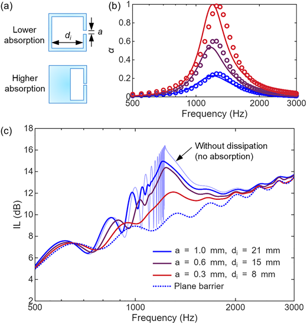

**Fig. 5** (a) Geometrical comparison of the two Helmholtz resonator unit cells used in the metabarrier: low-dissipation and high-dissipation designs. The high-dissipation unit features a reduced cavity depth and narrower neck to increase absorption while maintaining a similar resonance frequency to that of the low-dissipation unit. (b) Absorption coefficients of the two resonator designs. (c) Insertion loss (IL) of the metabarrier using each resonator type, along with the result when dissipation is neglected (no-dissipation case).

The results show that, when dissipation is neglected (no-dissipation case), dense peaks and dips appear just below the highest peak frequency. These peaks and dips originate from standing wave modes with extremely low wave velocities, approaching zero. However, when moderate dissipation is included (low-dissipation case), these peaks and dips are damped due to energy loss within the resonators. In contrast, as shown in Fig. 2(d), residual peaks and dips remain visible in the *a* = 2 mm and *a* = 3 mm cases, where the overall dissipation is lower.

When dissipation is further increased, the performance of the metabarrier deteriorates significantly. This is because the dissipation of the resonators prohibits the formation of the surface waves, as also noted by Li *et al.*32 We also note that a similar observation was reported by Yang *et al.*,38 where noise emission from a source inside a box-shaped cavity with one open side was investigated. In that work, Helmholtz resonators were applied along the cavity walls, and their impedance was tuned to minimize the emitted noise. When impedance-matched (*i.e.*, high-absorption) resonators were used, the overall system performance declined. These results suggest that, although high absorption is often desirable in many acoustic applications, it may not be the optimal solution in scenarios where waves are incident far from the normal direction to the resonator faces.

This analysis further demonstrates that the sound attenuation achieved by the metabarrier does not primarily result from sound dissipation within the resonators. Instead, the role of dissipation is limited to dampening the small peaks and dips observed in the IL spectrum, and high dissipation can rather diminish the performance of the barrier. These findings confirm that the metabarrier's effectiveness in attenuating sound mainly originates from the interplay between wave diffraction and scattering by the periodically arranged resonators. This interaction alters the propagation of incident waves, redistributing acoustic energy and leading to significant reductions in transmitted sound levels. Although detailed resonator optimization is beyond the scope of this study, future research could investigate design strategies that maximize the beneficial diffraction–resonator coupling while avoiding excessive damping.

We note that, due to the localized nature of the sound attenuation mechanisms underlying the metabarrier, its performance is most effective at closer distances from the barrier. As the receiver location moves farther away from the barrier face, the additional attenuation provided by the metabarrier decreases significantly, as demonstrated in Section S6, SI. Consequently, the metabarrier is best suited for applications in which noise reduction is required in regions close to the barrier, such as immediately adjacent to traffic corridors or noise-sensitive zones.

## 4 Metabarriers with double-sided resonators

The metabarrier design discussed in the previous sections consists of a single array of periodic resonators. In this section, we expand the design to consider a double array of resonators positioned on opposite sides. Fig. 6(a)–(c) show the ILs of three types of metabarriers made from double-sided resonator arrays calculated at receiver positions R1–R4 shown in Fig. 1(d). The left panel of Fig. 6(g) displays the unit cell of the double-array metabarrier. The metabarrier design includes 20 unit cells stacked on top of each other, forming a 0.5 m high noise barrier. The results in Fig. 6(a) correspond to metabarriers with identical resonators on both sides (*a*1 = *a*2 = 1 mm), while the results in Fig. 6(b) and (c) show double-array metabarriers with a 1 mm neck on one side and a 3 mm neck on the other side. These double-array metabarriers have an increased width of 2<em>W</em> (= 50 mm). For comparison, the insertion loss values of a plane noise barrier with the same width 2<em>W</em> are also included in Fig. 6(a)–(c) (represented by dotted lines).

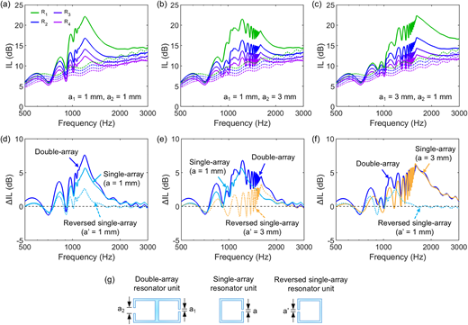

**Fig. 6** Sound attenuation by double-side metabarriers. Insertion losses by double-sided metabarriers with resonator neck widths (a) *a*1 = 1 mm, *a*2 = 1 mm, (b) *a*1 = 1 mm, *a*2 = 3 mm, and (c) *a*1 = 3 mm, *a*2 = 1 mm. The differences in insertion losses between the metabarriers and plane barriers are shown in (d), (e), and (f) for the configurations considered in (a), (b), and (c), respectively. (g) Configurations of double-array resonator unit (left), single-array resonator unit (middle), and reversed single-array resonator unit (right).

Examining the results presented in Fig. 6(a), the double-array barrier of two identical resonators exhibits higher ILs than the single-array barrier of the same resonators. For instance, the highest peak of the double-array barrier calculated at R1 is 22.14 dB, while that of the single-array barrier is 19.86 dB. The increase in insertion loss is due to the contribution from both sides of the resonator arrays. Fig. 6(d) shows the ΔILs of the double-array barrier and those of two configurations of single-array barriers: original single-array configuration (resonators facing the right-hand side) and reversed configuration (resonators facing the left-hand side). The unit cells of these two configurations are also shown in Fig. 6(g). The IL values of the double-array barrier approximate the sum of the IL values of the single-array barriers. This result suggests that the sound attenuation of the metabarriers can be further improved by utilizing the synergistic effect of the other side of the barrier. It should be also noted that merely doubling the width of the plane barrier to 2<em>W</em> almost has no influence on sound attenuation, as shown in Fig. 1(c).

Modifying the resonance frequencies of the resonators on one side enables the double-array barrier to achieve combined sound attenuation from the two different resonator arrays. Fig. 6(b) and (c) present the ILs of double-array barriers made of resonators with a right-hand side resonator array of *a*1 = 1 mm and left-hand side array of *a*2 = 3 mm, and *vice versa* (*a*1 = 3 mm, *a*2 = 1 mm). Fig. 6(e) and (f) present the ΔIL of those two cases, as well as the contribution of the normal and reversed single-array barriers. The same as the case with the double-array barriers with two identical resonators, utilizing two different resonators exhibits the combined effects of the single-array barriers with two different resonators. Therefore, by varying the resonance frequencies, the double-array barrier can provide broader frequency coverage, enhancing attenuation across a wider frequency range. This strategy can be particularly useful in environments with a broad spectrum of noise frequencies.

Alternatively, the same barrier width can be maintained by arranging the resonators alternately to face opposite sides. The results for such configurations are presented in Section S7 of the SI.

## 5 Experimental validation

The performance of the metabarrier was experimentally validated using a 2D waveguide. Fig. 7(a) and (b) show a schematic illustration and a photograph of the measurement setup. The metabarrier and plane barrier were fabricated using a stereolithography (SLA) 3D printer. The material properties of the printing material are *ρ* (density) = 1170 kg m−3, *E* (Young's modulus) = 2.56 GPa, *ν* (Poisson's ratio) = 0.30, and *η* (loss factor) = 0.05. The printed barriers are installed on a 25 mm thick aluminum reflector. This reflector works as a fully reflecting ground surface. The 2D waveguide was constructed by placing a 10 mm thick acrylic plate above the metabarrier sample and a reflector placed on an optical table (2400 mm × 1500 mm). An air cavity of 55 mm between the table and acrylic plate resulted in a waveguide cutoff frequency of approximately 3100 Hz. Sound-absorbing wedges, 350 mm in height and 100 mm in width, were placed around the waveguide to minimize boundary reflections. An array of 8 speakers (10 W, 50 mm diameter) was positioned 750 mm from the left-hand side of the barrier sample. A sine-sweep signal from 500 Hz to 3000 Hz was generated by a function generator (Keysight 33500B). The sound pressure levels were measured on the right-hand side of the barrier using a 1/4-inch free-field microphone (B&K Type 4939), placed 100 mm from the sample and 20 mm from the reflector. The sound pressure signals were acquired at a sampling rate of 65 536 Hz using a data acquisition system (PAK-Mobile MK-II Systems, MÜLLER-BBM). The 1/6 octave band analysis was performed for center frequencies ranging from 125 Hz to 5000 Hz with a time block of 1 second, corresponding to a frequency resolution of 1 Hz. The signals were processed using a Hanning window with a 66.7% overlap, and the sound pressure levels were averaged over a total duration of 30 seconds. IL was determined by subtracting the sound pressure level with the sample from that without the sample.

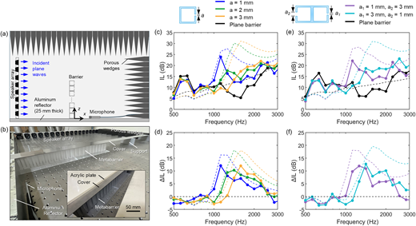

**Fig. 7** Experimental setup and results. (a) Schematic illustration and (b) photograph of the measurement setup. (c) and (d) show the comparison between the insertion loss (IL) and insertion loss difference (ΔIL) obtained by numerical simulation (dotted lines) and measurements (solid lines with markers) for single-array metabarriers with different neck widths. (e) and (f) show the results of double-array metabarriers.

Measurements were performed for three types of single-array metabarriers (resonator neck widths *a* = 1 mm, 2 mm, and 3 mm) and two types of double-array metabarriers (*a*1 = 1 mm, *a*2 = 3 mm and *a*1 = 3 mm, *a*2 = 1 mm). For comparison, plane barriers with widths of *W* = 25 mm and 2 *W* = 50 mm were also tested. Fig. 7(c)–(f) show the comparison of IL ((c) and (e)) and ΔIL ((d) and (f)) obtained by the measurements (solid lines with markers) and the numerical simulations (dashed lines) for the single- and double-array cases. Both simulation data and measurement data were averaged over 1/6 octave bands. While some discrepancies are observed in IL values presented in Fig. 7(c) and (e), the ΔIL values presented in Fig. 7(d) and (f) show good agreement. These discrepancies can be attributed to the influence of the reflection from the waveguide's right-hand side boundary. Although the microphone was placed relatively close to the barrier to reduce these effects, they could not be completely eliminated. Consequently, the measured IL values were notably lower than the simulated data in the 1000–2000 Hz range for both the metabarrier and plane barrier cases. However, in general, the measurement results agree well with the simulation results in ΔIL, both in terms of values and peak locations. Specifically, the increase in IL below the peak frequencies is attributed to the combined effects of standing waves and surface waves discussed in this work. Thus, the measurement results validate the mechanisms of the metabarriers and confirm their superiority over plane barriers.

## 6 Conclusions

In this work, we demonstrated that metabarriers, consisting of vertically stacked resonator arrays, exhibit a significantly higher noise reduction performance across a broad frequency range compared to conventional noise barriers. We identified two distinct mechanisms responsible for this enhanced sound attenuation: First, the sound waves diffracting at the top of the barrier propagate along the barrier's surface as guided surface waves for frequencies below the resonance frequency of the resonators. The surface waves form standing wave modes due to their interaction with reflected waves from the ground. These standing wave modes are strongly confined to the region near the surface of the resonators; therefore, less sound energy is transmitted to the other side of the barrier. The slower velocities of these surface waves also shift and condense the peak frequencies below the resonance frequency of the unit resonator. Second, around the resonance frequency, the wave propagation behavior around the noise barrier is comparable to a localized resonance-induced band gap. Due to the strong evanescent nature within this band gap, the highest peak in insertion loss is observed.

Building on these findings, we explored design variants using periodic double-sided resonators. Our analysis revealed that placing resonators on both sides of the barrier creates synergistic effects, allowing the double-sided metabarrier to combine the sound attenuation characteristics of both resonator arrays. This approach broadens the effective frequency range of attenuation by incorporating resonators with different resonance frequencies.

A key advantage of metabarriers is their simple and scalable design, making them easily attachable to existing noise barrier structures. Future research could focus on optimizing resonator geometries to maximize the attenuation efficiency. Moreover, by incorporating adaptive or tunable resonators,46,47 real-time adjustment of resonance frequencies in response to changing noise environments will become possible. We believe that these findings also offer new insight into the use of structured interfaces for wave control and may be extended to related domains such as vibration isolation, elastic wave control, or aeroacoustic shielding.

## Author contributions

J. Yang: conceptualization, methodology, software, formal analysis, investigation, writing – original draft, and visualization. P.-S. Ma: validation, formal analysis, investigation, resources, writing – review and editing, and visualization.

## Conflicts of interest

The authors declare that they have no known competing financial interests or personal relationships that could have appeared to influence the work reported in this paper.

## Data availability

Supplementary data supporting this study are included in the supplementary information (SI). See DOI: [https://doi.org/10.1039/d5mh02051d](https://doi.org/10.1039/d5mh02051d).

Additional data are available from the corresponding authors upon reasonable request.

## Acknowledgements

J. Yang acknowledges that the initial concept for this research was supported by funding from the European Union's Horizon 2020 Research and Innovation Programme under the Marie Skłodowska-Curie Grant Agreement No. 754462. P.-S. Ma acknowledges that this work was supported by Gachon University research fund of 2025 (GCU-202500610001).

## Supplementary Materials

- [Supplementary information (PDF)](https://pubs.rsc.org/mh/article-supplement/897545/pdf/d5mh02051d1_suppl/)

## References (47 total, showing 47)

1. World Health Organization, Compendium of WHO and Other UN Guidance on Health and Environment, 2024 Update, World Health Organization, 2024.

2. World Health Organization, Burden of Disease from Environmental Noise: Quantification of Healthy Life Years Lost in Europe, WHO Regional Office for Europe, 2011.

3. K. Attenborough and T. van Renterghem, *Predicting Outdoor Sound*, CRC Press, 2nd edn, 2021.

4. D. N. May and N. M. Osman, *J. Sound Vib.*, 1980, 71, 73–101.

5. D. C. Hothersall, D. H. Crombie and S. N. Chandler-Wilde, *Appl. Acoust.*, 1991, 32, 269–287.

6. Y. Wang, Y. Jiao and Z. Chen, *Appl. Acoust.*, 2018, 133, 118–122.

7. T. Okubo and K. Fujiwara, *J. Acoust. Soc. Am.*, 1999, 105, 3326–3335.

8. M. Möser and R. Volz, *J. Acoust. Soc. Am.*, 1999, 106, 3049–3060.

9. P. Menounou and H. Y. Jeong, *J. Acoust. Soc. Am.*, 2004, 116, 2843–2854.

10. S. Grubeša, K. Jambrošić and H. Domitrović, *Appl. Acoust.*, 2012, 73, 1129–1137.

11. F. Jiang, W. Zhao, L. Chen, C. Zheng and H. Chen, *Eng. Anal. Bound Elem.*, 2021, 124, 124–136.

12. K. H. Kim and G. H. Yoon, *J. Sound Vib.*, 2015, 339, 123–142.

13. W. Zhao, L. Chen, C. Zheng, C. Liu and H. Chen, *Struct. Multidiscipl. Optim.*, 2017, 56, 315–329.

14. M. Yang, S. Chen, C. Fu and P. Sheng, *Mater. Horiz.*, 2017, 4, 673–680.

15. G. Liao, C. Luan, Z. Wang, J. Liu, X. Yao and J. Fu, *Adv. Mater. Technol.*, 2021, 6, 2000787.

16. N. Gao, Z. Zhang, J. Deng, X. Guo, B. Cheng and H. Hou, *Adv. Mater. Technol.*, 2022, 7, 2100698.

17. J. Zhang, B. Hu and S. Wang, *Appl. Phys. Lett.*, 2023, 123, 010502.

18. J. V. Sanchez-Perez, C. Rubio, R. Martinez-Sala, R. Sanchez-Grandia and V. Gomez, *Appl. Phys. Lett.*, 2002, 81, 5240–5242.

19. J. Sánchez-Dehesa, V. M. Garcia-Chocano, D. Torrent, F. Cervera, S. Cabrera and F. Simon, *J. Acoust. Soc. Am.*, 2011, 129, 1173–1183.

20. B. van der Aa and J. Forssén, *J. Phys. D: Appl. Phys.*, 2015, 48, 295501.

21. G. Ke and Z. C. Zheng, *J. Sound Vib.*, 2016, 370, 43–53.

22. M. Thota and K. W. Wang, *J. Appl. Phys.*, 2017, 122, 154901.

23. V. M. García-Chocano, S. Cabrera and J. Sánchez-Dehesa, *Appl. Phys. Lett.*, 2012, 101, 184101.

24. S. M. Dimitrijević, V. M. García-Chocano, F. Cervera, E. Roth and J. Sánchez-Dehesa, *Materials*, 2019, 12, 2806.

25. A. Krynkin, O. Umnova, A. Y. Chong, S. Taherzadeh and K. Attenborough, *J. Phys. D: Appl. Phys.*, 2011, 44, 125501.

26. J. Radosz, *Appl. Acoust.*, 2019, 155, 492–499.

27. K. Mohapatra and D. Jena, *Appl. Acoust.*, 2021, 171, 107676.

28. L. Wu, Z. Zhai, X. Zhao, X. Tian, D. Li, Q. Wang and H. Jiang, *Adv. Funct. Mater.*, 2022, 32, 2105712.

29. L. Quan, X. Zhong, X. Liu, X. Gong and P. A. Johnson, *Nat. Commun.*, 2014, 5, 1–8.

30. L. Quan, F. Qian, X. Liu, X. Gong and P. A. Johnson, *Phys. Rev. B: Condens. Matter Mater. Phys.*, 2015, 92, 104105.

31. L. Schwan, A. Geslain, V. Romero-García and J.-P. Groby, *Appl. Phys. Lett.*, 2017, 110, 051902.

32. H.-x Li, J.-j Liu, Z.-x Chen, K. Wu, B. Liang, J. Yang, J.-c Cheng and J. Christensen, *Nat. Commun.*, 2023, 14, 7633.

33. D. B. Moore, J. D. Smith, J. R. Sambles, A. P. Hibbins and T. A. Starkey, *Phys. Rev. B*, 2025, 111, 155427.

34. N. Fang, D. Xi, J. Xu, M. Ambati, W. Srituravanich, C. Sun and X. Zhang, *Nat. Mater.*, 2006, 5, 452–456.

35. X. Hu, K. M. Ho, C. T. Chan and J. Zi, *Phys. Rev. B: Condens. Matter Mater. Phys.*, 2008, 77, 172301.

36. X. Li, X. Yu, J. W. Chua and W. Zhai, *Mater. Horiz.*, 2023, 10, 2892–2903.

37. Z. Li, X. Li, Z. Wang and W. Zhai, *Mater. Horiz.*, 2023, 10, 75–87.

38. E. Yang, J. Kim and W. Jeon, *Mech. Syst. Signal Process.*, 2024, 209, 111054.

39. Z. Mei, T. Shi, Y. Lyu, X. Li, X. Cheng and J. Yang, *Mech. Syst. Signal Process.*, 2025, 226, 112348.

40. S.-S. Lee, J.-Y. Jang and K. Song, *Mech. Syst. Signal Process.*, 2025, 222, 111744.

41. Z. Wang, X. Lu, Z. Guo, Z. Li, Z. Lei, K. Zeng and Y. Zhao, *Int. J. Mech. Sci.*, 2025, 289, 110056.

42. F. Ma, C. Wang, Y. Du, Z. Zhu and J. H. Wu, *Mater. Horiz.*, 2022, 9, 653–662.

43. J.-Y. Jang, C.-S. Park and K. Song, *Mech. Syst. Signal Process.*, 2022, 178, 109270.

44. COMSOL Multiphysics v.6.3. COMSOL AB, Stockholm, Sweden.

45. T. J. Cox and P. D’Antonio, *Acoustic Absorbers and Diffusers: Theory, Design and Application*, CRC Press, 3rd edn, 2017.

46. M. Shrestha, G. K. Lau, Y. W. Chin, E. H. T. Teo, B. C. Khoo and Z. B. Lu, *Commun. Eng.*, 2024, 3, 1–11.

47. Y. Zhang, L. Chang, T. Wang, S. Han, J. Li, P. Fan, X. Ding, F. Tang, Y. Hu and A. Aabloo, *Mater. Horiz.*, 2025, 10281–10291.
