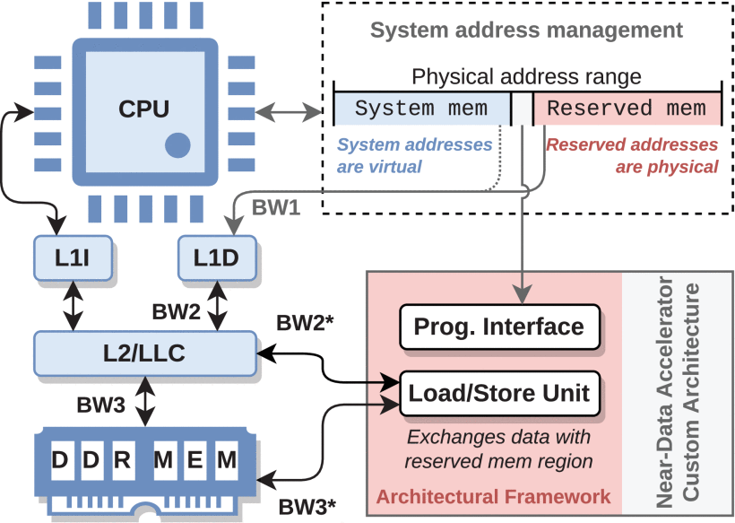

# NDPmulator: Enabling Full-System Simulation for Near-Data Accelerators From Caches to DRAM

**Abstract.** The accurate simulation and performance assessment of Near-Data Accelerators (NDAccs) is a complex challenge as it must consider the operation of the entire processing system, the impact of the Operating System (OS) overheads, and the memory contention caused by concurrent processes. While recent proposals have attempted to repurpose and extend existing tools, the offered support for the development and evaluation of NDAccs is limited and full-system simulation is rarely provided. To mitigate this problem, the NDPmulator simulation framework, based on the widely established gem5 architectural simulator, is herein proposed. NDPmulator provides System Emulation (SE) and Full System (FS) support for the development and evaluation of novel NDAccs deployed at multiple levels of the memory hierarchy. To demonstrate its versatility and performance-efficiency, the proposed NDPmulator is used to model three existing NDAccs, showing that it can accurately estimate and anticipate the results of the evaluation performed by the original authors while requiring a significantly smaller implementation effort and a fraction of the simulation time. Furthermore, NDPmulator offers the possibility to conduct complex experiments where the NDAcc is coupled to a real system featuring an OS. Hence it allows modeling all overheads related to the NDAcc device driver, the OS, and the contention caused by concurrent and background processes.

## Introduction

The observed emergence of new data-intensive algorithms in multiple application domains (e.g., image processing, bio-informatics, physics, finance, and artificial intelligence) has widened the performance gap between modern multi-core high-performance Central Processing Units (CPUs) and their corresponding memory hierarchies. Due to the increased complexity of memory subsystems (in an attempt to keep up with the performance delivered by the CPUs as well as the large data transfers required by data-intensive algorithms), a significant amount of energy is spent across interconnection wires, representing losses as high as 64%1. This contrasts with the 1% fraction of energy used for the actual computation2. Furthermore, despite the efforts made, current memory subsystems still cannot keep up with the performance of CPUs whenever large amounts of data are involved, resulting in performance degradation and low utilization of the CPUs3.

As result, an opportunity was created for specialized accelerators, which offer significant performance improvements over CPUs4, 5, 6 for two distinct reasons: (1) they are specifically optimized for a given application (or small set of applications), taking full advantage of its underlying characteristics, such as data access patterns and parallelization opportunities; and (2) they may be installed close to where data is stored (i.e., memory devices7, 8, 9, 10), becoming Near-Data Processing (NDP) devices, henceforth designated by Near-Data Accelerators (NDAccs), which grants them a much higher bandwidth and lower latency to memory than the CPU.

### A. Background on Near-Data Processing

Throughout the years, several NDAccs have been proposed, with initial designs focused on Processing in Memory (PIM). PIM devices make use of the already existing Dynamic Random Access Memory (DRAM) resources to implement elementary bit-line operations, which consist of reading the combined charges of multiple DRAM cells and interpreting the voltage level at the sense amplifiers as the result of a digital operation. By applying this technique simultaneously in multiple DRAM banks, a massive level of parallelism can be achieved. However, only elementary digital operations can be implemented at this level11, often requiring hundreds of these operations to implement more complex arithmetic instructions12. Furthermore, since these circuits operate in the analog domain, PIM techniques are often error-prone, and only a small number of bits within one column can be combined successfully13. This particular limitation was later mitigated by extending the PIM paradigm to Static Random Access Memory (SRAM)2, 14, which is more resilient to non-recoverable errors when combining large amounts of bits. In addition, recent proposals also make use of 3D-stacked NAND-memory (a technology frequently used to fabricate non-volatile memory devices) to implement active computation15.

More recently, Resistive Random Access Memory (RRAM)-based PIM16, 17, 18, 19, 20, 21, 22 techniques have gained significant popularity. One of its most relevant features is supporting the implementation of analog multiplication23, which is the core operation of Convolutional Neural Networks (CNNs). By manipulating the impedance of the memristors, as well as the reading voltage, the result of a read operation can be interpreted as the product of both. However, analog RRAM-PIM is also error-prone since the behavior of the memristors varies with temperature during operation. Furthermore, RRAM fabrication suffers from significant process variations, making the memristors uneven within the same device and between devices24. Therefore, reported results indicate that analog RRAM-PIM devices are more than error-prone: they are unstable and produce untrustworthy results. Nevertheless, digital bit-wise RRAM-PIM is also possible by combining several memristors25, highly increasing the error tolerance.

Despite the important advances that have been made, PIM remains limited to bit-wise operations, is often error-prone, is constrained by the existing memory hardware, and requires very specific data placements. Moreover, the required awareness of how the data is stored in the memory devices is hardly compatible with the security mechanisms used by modern Operating Systems (OSs) and makes it difficult to create a standard programming paradigm. Hence, the adoption of PIM solutions for general-purpose computation is not common, and these devices are mostly used in specialized systems targeting a single algorithm14, 26 or a very restricted group of applications.

Nevertheless, there is also a class of NDAccs that reside outside the memory devices, allowing for much higher design freedom including the adoption of fully-digital architectures capable of atomically executing complex operations that would otherwise take hundreds of cycles to be implemented using bit-line computations27, 28, 29, 30. Such NDAccs are more independent of the underlying memory architecture and simplify data placement comparing with PIM devices, which provides for easier integration with modern processing systems and mitigates security issues. Although these devices are characterized by a lower bandwidth to memory (when compared with PIM devices), they still benefit from much higher data rates than the CPU. Furthermore, since they are physically closer to memory, the energy spent transferring data across wires is also reduced. As a result, this paradigm allows for the implementation of general-purpose solutions.

However, the design of novel NDAccs is a complex task. Moreover, directly prototyping such accelerators by developing Register-Transfer Level (RTL) code is generally complex, expensive, and time-consuming, in particular when the intended goal is to simply evaluate the potential of an idea, or to adjust the parameters of an architecture still under consideration. In addition, without properly integrating the accelerator with the remaining system, particularly with the main CPU and the memory hierarchy, such methodologies may lead to inaccurate results. These are due to control and synchronization overheads or the contention generated at memory level attributed to the co- existence of several processing devices simultaneously accessing the memory hierarchy.

### B. Motivation

During the past decade, several contributions have been made to tackle the challenges involved in the conception of pre-RTL development tools, targeting heterogeneous high-performance processing systems. They point out important problems, such as the lack of sufficiently accurate models and the scalability of existing solutions31, 32, 33, 34, 35, 36. **Although relevant proposals on design exploration and performance prediction were presented, they usually target fairly homogeneous systems (such as conventional multi-core CPU systems37, 38, 39), and are hardly suited for heterogeneous systems featuring specialized hardware accelerators.** Furthermore, they are also unsuited for early design exploration phases (where the parameterization of the architectures is not fixed yet), as a detailed specification of the device is usually required40.

In addition, most artifacts used in the literature are either not optimized to evaluate NDAccs (e.g., in41, the authors use a Graphics Processing Unit (GPU) simulator to evaluate their NDP architecture), are limited to few architectures42, or depend on post-simulation steps to combine the performance metrics of the NDAccs with the remaining system (resulting in the inability to simulate the simultaneous operation of the CPU and the NDAcc). This not only makes it difficult to establish comparisons between such evaluation methodologies but may also bring into question the validity of the obtained results.

**Hence, it is fundamental to develop rigorous mechanisms dedicated to the evaluation of the benefits of new NDAccs without undergoing the expensive development steps required by traditional full-scale methods, while still allowing to obtain accurate and trustworthy results.**

### C. Contributions

To answer this need, **this paper proposes a new pre-RTL simulation framework specifically aimed at evaluating NDAccs, allowing to emulate their operation at different levels of proximity to memory devices.** The presented framework, denominated NDPmulator, is based on the widely established gem5 architectural simulator43 and gem5-accel44, 45, offering a full-stack development and evaluation solution for new NDAccs. However, contrasting with44, **NDPmulator not only supports the simulation of individual applications using an NDAcc (System Emulation (SE) mode), but also provides the ability to execute several applications in parallel on top of an OS (Full System (FS) mode)**, allowing for a comprehensive evaluation of NDAccs under realistic circumstances, with accurate results. Furthermore, it natively supports all Instruction Set Architectures (ISAs) allowed by gem5 in SE mode and x86, ARM, and RISC-V in FS mode (in contrast with44, which only supported the ARM ISA). It also includes Linux device drivers to easily establish communication between a CPU application and the NDAcc under evaluation. In addition, this work presents a comprehensive analysis of the development flow of NDAccs using FS mode (which was not included in45), together with a rich set of use cases, and a detailed analysis of the different components of NDPmulator’s architectural model.

**To our knowledge, NDPmulator is the first cycle-accurate simulation tool providing a full-stack solution specifically aimed at the development of NDAccs**, covering not only the conception of the accelerator architecture but also its integration with the processing system and the co- execution of real NDP-enabled applications that make use of NDAccs.

To validate our framework, we modeled three NDAccs recently proposed in the literature46, 47, 48, 49 (together with the respective underlying processing systems) and evaluated them using NDPmulator, comparing the obtained results with those of the original papers. Our results show that NDPmulator allows to successfully estimate the performance of said NDAccs at the cost of a small fraction of the implementation time and without the need to actually synthesize their architectures, thus adopting a pure simulation approach. Furthermore, we further complemented the validation of the devised toolchain by exposing features of NDPmulator that were not explored (or available) in45. Namely, we evaluated the NDAcc proposed by Das and Kapoor46, by considering its integration with a realistic processing environment featuring the coexistence with an OS. In addition, to better demonstrate the versatility and efficacy of NDPmulator, we conducted two additional tests regarding the NDAcc inspired in49: (1) we compared the simulation time of a Verilator-based official simulation platform with that of NDPmulator, showing that NDPmulator allows to obtain the same results in a fraction of the time; and (2) we simulated two scenarios considering the NDAcc connected to the Last-Level Cache (LLC) (L2 cache) when parameterized with different bandwidths, demonstrating that NDPmulator allows changing core features of the system by simply adjusting parameters in the simulation file.

*All in all, this paper presents the following contributions:*

- An open-source gem5-based simulation framework targeting the development and an early evaluation of NDAccs, providing support for the development of their architectures and integration with the remaining processing system;
- Full support for simulating the simultaneous operation of the CPU and the NDAcc on a clock-cycle basis;
- Support for both SE and FS simulation, allowing to accurately evaluate NDAccs with a single application using an NDAcc or multiple processes on top of an OS;
- Native support for all ISAs supported by gem5 in SE mode, and support for x86, ARM, and RISC-V in FS mode;
- Simulation scripts targeting both SE and FS modes;
- NDAcc Linux device drivers to be used in FS mode;
- Extensive validation of NDPmulator, considering three distinct NDAccs from the literature, showing its versatility, accuracy, and simulation efficiency when compared with other state-of-the-art platforms.

The remainder of this paper is organized as follows. Section II details the proposed framework. Section III explains the simulation flow of NDPmulator for both SE and FS modes, providing examples of its operation. Section IV briefly describes the NDAccs proposed by Das and Kapoor46, Wang et al.47, 48, and Genc et al.49 whose architectures were used to validate NDPmulator, and presents as discusses the obtained experimental results. Section V summarizes relevant related work. Finally, Section VI concludes this paper.

## NDPmulator Architectural Framework

NDPmulator is based on the widely established gem5 architectural simulator43, an event-driven simulator that delivers cycle-accurate results and capable of emulating the latency associated to each block in the processing system, as well as the inherent data contention. While an extensive list of modules can be simulated out of the box in gem5, simulating custom hardware architectures requires the implementation of the corresponding models. This task is particularly complex for NDAccs due to the need of coupling them to an existing CPU and memory hierarchy, which requires to implement the packet communication protocol needed to exchange data with the CPU (for control purposes) and the memory hierarchy (for obtaining operands and storing results).

The architectural model of NDPmulator provides two main mechanisms to simplify the integration of custom NDAccs with standard processing systems, as depicted in Fig. 1. The first mechanism is a Programming Interface (PI), which implements programming registers to provide a direct interface between the CPU and the NDAcc for control purposes. The size and total amount of registers are configurable parameters of NDPmulator, and it is up to the developer to define the purpose of each register, as these parameters depend on the implemented architecture. The second mechanism is a load/store unit that retrieves the operands from memory and stores the results by breaking down the high-level memory requests performed by the NDAcc into simpler requests that are sent to memory. By doing so, the load/store unit conceals the complex communication protocols used to transfer data between the memory devices and the processing elements, automatically dealing with failed request attempts (e.g., due to contention) and granting the delivery of the requested data to the NDAcc/memory.

**Figure 1.** Physical representation of the proposed NDPmulator. BW2\* and BW3\* represent configurable parameters that define the bandwidths between the different levels of the memory hierarchy and the NDAcc. The L1I and L1D blocks represent L1 instruction and data caches, respectively, while the L2/LLC block represents the L2 unified cache, which corresponds to the Last-Level Cache of the depicted system.

It is also worth mentioning that NDPmulator does not impose any fixed operation flow between the CPU and the NDAcc, i.e., the user may choose to implement a fine-grained control over the NDAcc (e.g., issue atomic instructions by reading or writing to the PI), or a more decentralized control where the NDAcc acts similarly to a co- processor (e.g., order the NDAcc to execute an entire pre-compiled kernel fetched from memory), as illustrated in Fig. 2.

**Figure 2.** Example operation of an NDAcc and its interaction with the surrounding system: (1) the CPU stores the NDAcc kernel in memory; (2) the CPU triggers the NDAcc to start operating; (3) the NDAcc exchanges operands and results with the memory hierarchy; (4) CPU polls the NDAcc.

Furthermore, by being based on gem5, NDPmulator is modular and can be extended to support specific evaluation requirements of custom NDAcc architectures. For example, specific metrics can be obtained regarding the operation of certain modules within the custom NDAcc architecture. Also, specific hardware and power models can be created for posterior processing using McPAT50 and/or Cacti51.

### A. CPU-NDAcc Programming Interface

The proposed architectural model, built on top of gem5, addresses the complex architecture of the entire processing system, making it easier for users to integrate their NDAcc architectures. One of the provided features is the generation of a PI, which is responsible for implementing direct communication channels between the CPU and the NDAcc for control purposes. The number and size of the registers within the PI are configurable parameters of NDPmulator, and their purpose is defined by the developer, according to the requirements of the implemented custom NDAcc architecture. As illustrated in Fig. 3, whenever the CPU accesses the PI registers for reading or writing, the corresponding request is automatically processed by the offered framework module, and the methods `readPI` and `writePI` are executed to read or write the accessed programming register.

**Figure 3.** NDPmulator diagram relating the framework software routines to its main architectural blocks illustrated in the bottom right Section of Fig. 1, namely the *Prog. Interface* and the *Load/Store Unit.* It also shows the connections between the NDAcc and the main devices of the processing system depicted in Fig. 2.

It is worth emphasizing that the PI module offered by NDPmulator architectural model does not impose any restrictions on the internal architecture of the NDAccs. Specifically, it is unaware of their control flow and corresponding implementation, as well as the implemented operations and ISA. Furthermore, while actual data can be exchanged between the CPU and the NDAcc through the PI, it is only effective for small (scalar) operands and/or results. For retrieving large amounts of data to be processed and storing the corresponding results, NDPmulator provides a high-performance communication lane that connects the NDAcc with the underlying memory hierarchy.

### B. Load/Store Unit

The load/store unit features a memory port that enables the direct connection between the NDAcc and the memory hierarchy, for direct data access. Furthermore, it implements mechanisms that allow for the effortless retrieval of operands and storage of results produced by the NDAcc. Since memory models in gem5 have the same limitations as their corresponding physical devices, which impose a maximum request size, if a request for a burst of data to or from a memory device exceeds this maximum size, it must be broken down into smaller requests. To address this, NDPmulator load/store unit automatically partitions large memory requests into smaller ones, each with a size that is pursuant to the constraints of the memory device (e.g., cache line size). These requests are then sent sequentially and at a pace that can be configured. Furthermore, since memory devices may be busy and reject requests, the load/store unit implements a First-In-First-Out (FIFO) request queue that retries sending the dropped requests when the memory device becomes available again. For example, if the NDAcc model needs to obtain an entire vector from memory, it can do so by simply providing a descriptor via the `accessMemory` method, specifying the base address and the number of bytes required. Subsequently, the load/store unit schedules the necessary memory requests through the `sendData` method, ensuring that the data is retrieved as quickly as possible.

Fig. 4 illustrates the operation of NDPmulator load/store unit. First, the load/store unit verifies if the NDAcc request can be fulfilled in a single memory request. If that is the case, it creates a memory request of that size. Otherwise, it creates multiple requests with a size equal to or smaller than the maximum allowed size. Then, an attempt is made to send a single request to the memory device. If it succeeds and more memory requests are required to fulfill the original request made by the NDAcc, another attempt to send another request is scheduled. Otherwise, if it fails, the load/store unit waits until the memory device is ready again to retry sending the dropped request. This process is repeated until the original NDAcc request is fulfilled. When the memory returns a request response, the load/store unit matches the response with a previously issued request and stores the retrieved data in the corresponding slot on a Re-Order Buffer (ROB). When the received memory response concludes a request made by the NDAcc, the corresponding data stored in the ROB is transferred to the NDAcc and the memory transaction finishes.

**Figure 4.** Diagram showing how NDPmulator Load/Store Unit unfolds large requests into smaller ones suitable to be sent to the memory devices.

Another important feature of the load/store unit offered by NDPmulator is that it can be coupled to any level of the memory hierarchy (or even multiple levels), with the corresponding bandwidths allowed at the different levels being configurable parameters. In addition, since when NDAccs are coupled with a cache and communicate through the same ports used by the CPU cores, all the usual cache coherence protocols are still supported. Thus, NDAccs modeled using NDPmulator are independent of the used cache coherence protocol. NDPmulator also offers the option of bypassing the memory controller, which lets developers adjust the latency and behavior of the memory devices. This feature is particularly interesting for NDP design exploration, as it allows developers to emulate memory accesses using a custom latency. Additionally, NDPmulator is also compatible with having multiple NDAccs coupled to the same or different CPUs and memory devices.

An important aspect that has to be taken into account occurs when virtual memory mechanisms are considered since the data pointers made visible to user applications (virtual addresses) usually differ from those used to communicate with the memory hierarchy (physical addresses). Thus, in order to make this compatible with NDP, there needs to be an interfacing mechanism guaranteeing that, while the CPU application operates over virtual addresses, the NDAcc has access to the corresponding physical addresses to fetch the operands and store the results at physical level.

### C. Virtual Memory Translation and Management

In order to translate the virtual addresses used by the user application into their corresponding physical addresses (and vice-versa), two options are available. On the one hand, one can consider that the NDAcc receives the virtual addresses of the data to process and has to convert those addresses to the physical domain. This requires the NDAcc to implement a secondary Translation Lookaside Buffer (TLB), working as a subordinate of the core issuing the executing kernel, complemented by a hardware page walker to perform the translation. Naturally, this approach poses a significant overhead in terms of required hardware and execution time, considering that multiple accesses to the TLB will most likely be needed during the execution of a kernel, and page faults may occur, requiring to fetch page tables from memory.

On the other hand, there is a more efficient approach, where the NDAcc directly receives the physical addresses of the data (which is stored in contiguous memory segments), leaving the responsibility for the translation to the corresponding device driver. This scheme is commonly used by many other accelerators (including NVIDIA CUDA-enabled GPUs), where it is not convenient to work with page tables scattered across memory, as this imposes significant execution overheads. Hence, we emulate such a scheme by selecting a contiguous region within the existing physical memory and explicitly mapping it into an equally contiguous region in the virtual addressing space (to mimic a large page table), such that the virtual and physical addresses in that region are equal. As a consequence, the translation of addresses from the virtual to the physical domains becomes unnecessary, and the NDAcc is capable of accessing data within this region without explicit address translation.

It should be noted that such mechanisms do not relax any security aspects, which are still enforced to guarantee process isolation, preventing other processes from accessing CPU-NDAcc shared memory. In addition, the shared memory space between the CPU and the NDAcc has all the same features as the remaining addressing space, including being accessible by the CPU with the same latency as regular memory (since it exists in the same physical hardware). Hence, whenever required, this memory region can be used for purposes other than NDP, not being specialized for that single purpose (although NDPmulator would allow for that).

## Simulating NDP Devices with NDPmulator

NDPmulator supports simulating NDAccs based on the previously described architectural framework using two different modes: System Emulation (SE) and Full System (FS). In SE mode, a single application using the NDAcc is simulated alone, without OS. Consequently, no OS-specific mechanisms and/or restrictions are considered. Naturally, this simulation mode tends to be optimistic, since all OS-related overheads that would otherwise exist are not considered, or reduced to the minimum. Also, there is virtually no contention on the use of resources (besides the bandwidth limit), which leads to a scenario where the NDAcc has nearly-exclusive access to the memory hierarchy. Nevertheless, since process isolation mechanisms are light in SE mode, it is still possible to read and write the PI registers of the NDAcc by simply accessing the physical addresses where they are mapped into the CPU addressing space.

In contrast, FS mode simulates the execution under the premises of a conventional OS (Linux), leading to results more similar to those that would be obtained in a real multi-tasking system, where the OS plays a crucial part in managing hardware resources and provides important security enhancements such as process and memory isolation. As a consequence, non-privileged applications cannot directly access the system physical resources (due to security reasons). Thus, in order to establish communication between the user application and the NDAcc, the access to the NDAcc PI registers has to be delegated to the OS kernel through an appropriate device driver (see Fig. 5). However, this requires a more complex control flow on the application side, thus leading to extra programming overhead.

**Figure 5.** The device driver interfaces an application with the physical NDAcc by accessing its PI registers at privileged kernel level.

The following subsections describe the parameterization and simulation procedures corresponding to these two simulation modes (SE and FS).

### A. SE Mode Simulation

NDPmulator provides two important mechanisms to simulate NDAccs using SE mode: (1) gem5 SE scripts that connect the several system components; and (2) a programming paradigm/libraries that implement the routines required to control the NDAcc by reading and writing in its PI registers. Listing 1 illustrates a partial SE script that simulates an NDAcc connected to a standard processing system.

**Listing 1.** Partial gem5 SE script simulating a standard processing system and a memory hierarchy with an NDAcc by making use of NDPmulator. In this example, the NDAcc is connected to the L2 cache. Nevertheless, NDPmulator allows to connect one or more NDAccs to any level of the memory hierarchy (or even multiple levels).

The underlying processing system considered in this example is composed of a standard CPU, a two-level cache hierarchy, and a DRAM (see Part 1). In Part 2, the considered NDAcc is instantiated and its PI registers are mapped into the CPU address space (in this example, in addresses ranging from 1 GiB to 1 GiB + 4 KiB). Part 3 of the simulation script connects the NDAcc to both the CPU and the memory hierarchy using configurable buses. By changing the width of these buses and the parameters of the memory components, it is possible to control the bandwidth made available to the NDAcc, allowing to simulate NDAccs with different levels of proximity to the memory. Although in this example the NDAcc is coupled to the L2 cache, it can be as easily integrated with the L1 cache or the DRAM memory. Full scripts exemplifying how to achieve this are available at [https://github.com/hpc-ulisboa/NDPmulator](https://github.com/hpc-ulisboa/NDPmulator). It is worth noting that, although SE mode does not simulate the OS layer, it still emulates some of its features for compatibility purposes such as handling system calls or the existence of a virtual memory system. Therefore, it still requires translating virtual addresses to physical addresses and vice-versa. To tackle this, NDPmulator directly maps a section of the physical memory device into a specific virtual address range, allowing access to the data without the need for explicit translation, as shown in Part 4.

A simple C code example using an NDAcc whose operation flow is compatible with the one illustrated in Fig. 2 targeting the SE mode is illustrated in Listing 2. First, the data pointers representing both the NDAcc PI registers and the shared memory region between the CPU and NDAcc are set statically to the corresponding (physical) addresses, since there is no OS. Then, both the operands and the kernel are loaded into memory and the CPU instructs the NDAcc to start executing the kernel. During the operation of the NDAcc, the CPU is free to execute other tasks. Finally, the CPU reaches the synchronization point where the results produced by the NDAcc are required for post-processing.

**Listing 2.** C code example to initialize and control an NDAcc using NDPmulator SE mode. The routines `initData` and `initKernel` preload the data and the kernel into the memory region shared with the NDAcc.\_\_`ndaccLaunchKernel` instructs the NDAcc to execute the kernel and\_\_`ndaccReady` checks (pooling) if the NDAcc finished processing. Both these routines are implemented by the user who also defines the programming interface of the NDAcc.

### B. FS Mode Simulation

While SE mode is useful for validating and obtaining preliminary results of custom NDAcc architectures, it does not necessarily simulate the conditions of a realistic system due to the previously discussed limitations. On the other hand, FS mode provides a simulation scenario identical to a real system, allowing for a more thorough evaluation. Listing 3 illustrates relevant parts of an FS simulation script which describes a system identical to the one used in SE mode except that it also simulates a full-featured OS environment instead of simulating a single application in isolation. The complete FS simulation scripts can be found in the NDPmulator online repository ([https://github.com/hpc-ulisboa/NDPmulator](https://github.com/hpc-ulisboa/NDPmulator)).

**Listing 3.** Partial gem5 FS script integrating a standard processing system and memory hierarchy with an NDAcc.

Similarly to the previously referred SE simulation script, Part 1 and Part 2 instantiate and connect the components of a system featuring an NDAcc, a CPU, a two-level cache hierarchy, and a DRAM. A crucial difference between SE and FS simulation scripts is that the latest is ISA specific, i.e., the components of the simulated system vary depending on the ISA. In this example, an x86 CPU is used. Nevertheless, NDPmulator also supports ARM and RISC-V ISAs for FS mode simulation.

Due to the presence of the OS security mechanisms, process isolation is enforced in FS mode. As a consequence, a user application cannot directly access the physical hardware and has to do so using the implemented device drivers, which act as bridges between the applications and the simulated hardware devices, translating commands issued by the user applications into instructions that the NDAccs can understand (and vice-versa). First, the user application requests access to an NDAcc by sending a request to the OS. Then, the OS assigns that device to the requesting application and prevents any other process of acquiring its lock. The device driver initializes the NDAcc and prepares it for communication. Finally, the application can send commands to the device driver, which will be translated (at kernel level) into low-level instructions that can be interpreted by the physical device (in this example, read and write accesses to the NDAcc PI registers). In addition, the device driver is responsible for handling errors that may occur during the communication between user applications and the physical devices, acting as an extra layer of security and preventing one or more components of the system to undergo a non-recoverable undefined state.

Listing 4 illustrates an example of a C application that uses an NDAcc in FS mode (equivalent to that of Listing 2). As it can be observed, this code already incorporates functionalities provided by the OS, such as the use of the file system. It should be noted that it is no longer allowed to statically set the pointers to the NDAcc PI registers nor the NDAcc shared memory region to the corresponding physical addresses due to process isolation mechanisms implemented by the OS. Instead, the control of the NDAcc is implemented through a device driver (encapsulated by routines `__ndaccLaunchKernel` and `__ndaccReady`), and the memory regions to store the data to be processed and the kernel are also allocated (inside the CPU/NDAcc shared memory region) using OS mechanisms (wrapped by the method `ndaccAlloc`).

**Listing 4.** C code example to initialize and control an NDAcc using NDPmulator FS mode. Similarly to the SE mode, the routines `initData` and `initKernel` preload the data and the kernel into the memory region shared with the NDAcc.\_\_`ndaccLaunchKernel` instructs the NDAcc to execute the kernel and\_\_`ndaccReady` checks if the NDAcc finished processing. Both these routines are implemented by the user who is also responsible for implementing a device driver suitable for the NDAcc custom programming interface, for which NDPmulator provides templates and documentation.

Next Section summarizes the NDAcc architectures proposed in46, 47, 48, and49, which were used to validate NDPmulator.

## Experimental Evaluation

To validate and demonstrate the benefits of NDPmulator, three NDAcc architectures recently proposed in the literature were modeled using the information provided in the corresponding manuscripts. Then, a subset of the benchmarks originally used to evaluate those NDAccs were executed and the results compared with those reported by their authors.

### A. Near-Data Database Processing

The first modeled NDAcc was proposed by Das and Kapoor46 consisting in a Near-Data Compare Unit (NDCU) targeting the execution of common operations in Database (DB) applications. This NDAcc architecture is illustrated in Fig. 6. Specifically, the proposed NDCU has the capability of scanning column-store DBs (the values of the same attribute are stored sequentially in memory rows) and row-store DBs (the attributes of an entry are stored sequentially in memory rows), and implements the DB operations *compare-n-hit*, *compare-n-count*, and *compare-n-max*. The *compare-n-hit* operation scans the values of an attribute and sets the hit register only if a specified value is found; *compare-n-count* counts the number of occurrences of a value among all values of a given attribute; and *compare-n-max* scans the values of an attribute and determines its maximum value. Depending on the operation code sent by the CPU, the NDCU executes one of the three operations described above.

**Figure 6.** NDCU architecture proposed by Das and Kapoor46.

The authors placed their NDAcc in the logic layer of one or more vaults of an Hybrid Memory Cube (HMC), allowing to (1) directly fetch the operands from the stacked DRAM layers of each vault, (2) process the data, and (3) store back the results in the HMC.

Since the goal of this experiment is to demonstrate that NDPmulator allows to simulate NDAccs attached to any level of the memory hierarchy, it was decided to evaluate the devised NDCU when coupled to the L2 data cache. In addition, to facilitate the comparison between the results presented by Das and Kapoor46 and those obtained using NDPmulator, the conducted evaluation focus on the column-store DB benchmarks using a single NDCU.

To evaluate this NDAcc using NDPmulator, a total of four evaluation scenarios were considered and, for each scenario, five benchmarks extracted from the original paper46 were executed. In the first evaluation scenario, the SE mode was used with the NDCU connected to the L2 data cache. The remaining three evaluation scenarios used FS mode with the NDCU also coupled with the L2 data cache. These benchmarks were executed (1) with no other process running, (2) with another data-intensive workload being simultaneously executed in the CPU, and (3) using a device driver to intermediate the control of the NDCU via the OS kernel, while no other process was being executed. The five benchmarks used to evaluate the NDCU are summarized in Table 1 and all represent their data with 64-bit unsigned integers. It is also worth mentioning that the baseline used for both the SE and FS scenarios was the same used by Das and Kapoor46 in their original work, as shown in Table 1. Furthermore, all tests were made using the x86 ISA. For the FS mode setup, a recent Linux kernel (5.4.0-105) was used, together with the Ubuntu 18.04 root file system.

**TABLE 1** Parameters Used to Configure the Baseline System for the Evaluation of the NDCU Proposed in \[46\] and Executed Benchmarks

For convenience, it is assumed that all datasets used by the performed tests have $\mathrm {64~ \text {k} \text {byte} }$. Although this might result in small benchmarks, it is worth noting that it is not the goal of this paper to validate the NDAcc proposed in46, but to demonstrate the potential or capability of the proposed framework to reproduce and anticipate the results of such NDAccs. In particular, the use of smaller benchmarks is herein more interesting for highlighting the OS-related overheads, which are only observable when simulating in FS mode.

To facilitate the analysis of the results, Figs. 7 and 8 consider scenarios where the benchmarks executed in FS mode did not include any intermediary device driver. The communication between the CPU and the NDAcc was implemented by directly mapping the PI registers into the application addressing space (requiring superuser privileges) using the Linux system call `mmap`. Therefore, these scenarios do not consider the communication overhead introduced by the device driver. On the other hand, the results shown in Fig. 9 specifically target the quantification of the overhead introduced by the existence of the provided device driver.

**Figure 7.** Performance benefits of the NDCU presented in46. The second bar represents the results obtained by Das and Kapoor46 in their original evaluation. The third bar illustrates the estimated performance benefits of the NDCU modeled using NDPmulator when coupled to the L2 data cache in SE mode. Finally, the last bar depicts the performance benefits estimated using the FS mode of NDPmulator with the NDCU also coupled with the L2 cache. The results are presented in the same format as in the original paper46.

**Figure 8.** Execution time of the five benchmarks used to evaluate the NDCU proposed by Das and Kapoor46 obtained with NDPmulator FS mode. In (a), no other workload is being executed in parallel with the considered benchmarks. (b) illustrates a scenario where another data-intensive workload is being executed in parallel with the benchmarks. Due to its much smaller execution time, `hit best` results were represented using a different scale in the vertical axis.

**Figure 9.** Execution time of the five benchmarks used to evaluate the NDCU proposed in46 considering: only the CPU; the CPU plus the NDAcc being controlled by simply and directly reading and writing from/to its programming registers; the CPU and the NDAcc being controlled through a proper device driver (bars 3–5, each corresponding to a different run). Due to its much smaller execution time, `hit best` results were represented using a different scale in the vertical axis.

Fig. 7 presents the NDPmulator performance when simulating the same benchmarks used by Das and Kapoor46. In particular, the third bar in each set (green) was obtained using SE mode with the NDAcc coupled to the L2 cache. As it can be observed, the results obtained using the SE mode are very similar to those obtained in the original evaluation of the circuit presented by Das and Kapoor46, but requiring a rather smaller development cost to attain such estimation of performance. Moreover, the author’s original results were obtained considering NDP on an HMC, whereas we assess the performance of an equivalent system implemented near an L2 cache.

The last bar (red) considers a similar scenario except that FS mode is used. While significant performance benefits are still achieved (when compared with the baseline), the overall performance of the NDAcc is smaller. This can be explained by the overhead introduced by the OS. In particular, the OS overheads are lower for the `hit best` benchmark due to the reduced influence of the scheduler preemption mechanisms as the execution time is substantially lower. On the other hand, for the other benchmarks, the preemption mechanisms and the sparse and irregular memory accesses made by other background applications may introduce contention on shared resources, increasing the overall entropy at memory level and influencing the maximum data rate that can be achieved by the NDAcc. It is also worth noting that this effect is even more evident due to the rather short execution time of the benchmarks ($\mathrm {\sim 10~ \text {m} \text {s} }$).

The performance variations due to simultaneous accesses to the memory hierarchy are yet more visible in Fig. 8, where (a) shows the execution time of the CPU and the NDAcc when no other process is being executed in the CPU and (b) illustrates a scenario where another data-intensive workload is concurrently executing in the CPU, leading to simultaneous memory accesses that cause contention in the access to the shared resources and also pollutes data caches. It is worth mentioning that this scenario can only be evaluated by simulating the entire processing system, including the NDAcc and an OS running on top of the hardware infrastructure, in a real multi-tasking environment. To our knowledge, this is an exclusive feature of the FS mode provided by NDPmulator.

To conclude this evaluation, a device driver was developed to intermediate the communication between the CPU and the NDAcc using the provided OS security and isolation mechanisms. The corresponding results are illustrated in Fig. 9.

Although interfacing an application with the NDAcc through a device driver brings significant benefits in terms of security, it also has important implications in terms of performance. In this experiment, the synchronization points where the user application communicated with the NDAcc by directly accessing its PI registers were replaced by calls to the device driver, without modifying the structure of the code. The presented results show that the use of the device driver results in an overhead of up to 7 ms, which impact on the overall system performance, depending on the execution time of each issued NDAcc kernel. Naturally, since the execution time of the `hit best` benchmark is lower, the driver communication overhead leads to a higher relative increase in execution time.

Furthermore, the device-driver-based communication implemented between the CPU and the NDAcc is highly dependent on the underlying OS mechanisms, leading to significant performance variations even when executing the same workload several times. This effect can be seen in the last three bars of Fig. 9, which correspond to the exact same workloads (using the device driver) and yet produce results with a maximum difference of 6.4 ms.

### B. Near-Stream Computing

The second use case that was used to further corroborate the functionality of the proposed NDPmulator framework was the NDAcc presented by Wang et al.47, 48. Their architecture consists of Processing Element (PE) arrays installed close to the cache to perform arithmetic and logic vector operations, as depicted in Fig. 10. Their processing structure not only allows to take greater advantage of the memory devices bandwidth at that level of the hierarchy to increase the exploited parallelism but also allows the processing of data in a streamed manner, reducing the overall latency of operations. Furthermore, it includes a compiler solution to automatically make use of the considered hardware infrastructure, thus taking full advantage of its performance benefits.

**Figure 10.** NDAcc architecture proposed by Wang et al. \[47–48\].

In47, the authors attached their NDAcc close to the L3 data cache and assessed its performance benefits using a set of eight benchmarks. These same benchmarks were also used to evaluate this NDAcc architecture with the NDPmulator framework (see Table 2). Due to the unavailability of the compiler tool-chain used by Wang et al. (as well as the used implementation of the executed benchmarks), other common reference implementations of the said applications were used and modified to include explicit calls to the NDAcc. Furthermore, due to the unavailability of the same exact components used in the gem5 evaluation presented by Wang et al., the authors attempted to approximate (as much as possible) the original evaluation system using existing gem5 modules, as described in Table 2. Nevertheless, even with these restrictions, NDPmulator still allowed to approximate the original testing setup and obtain fairly accurate performance results, with three out of the eight tested benchmarks presenting an error below 5%, as shown in Fig. 11. All results regarding this use case were obtained using the SE mode. The data type used with this NDAcc was single-precision floating point (contrasting with 64-bit unsigned integers used with the architecture of Das and Kapoor46), showing that NDPmulator supports any data type used by the NDAcc.

**TABLE 2** Parameters Used to Configure the Baseline System for the Evaluation of the NDAcc Proposed in \[47\] and \[48\] and Executed Benchmarks

**Figure 11.** Performance benefits of the NDAcc proposed by Wang et al. 47\]–\[48 compared with those estimated using NDPmulator.

### C. Gemmini Accelerator

The third and final NDAcc used to validate NDPmulator was inspired in Gemmini49, an architectural framework to create accelerators targeting the execution of Neural Networks (NNs). The considered NDAcc (see Fig. 12) consists of a bi-dimensional systolic array of PEs, with each PE containing a Multiply-Accumulate (MAC) unit and communicating with its neighboring PEs through dedicated buses. Additionally, PEs can be arranged into tiles, which communicate with adjacent tiles through pipeline registers.

**Figure 12.** Generic architecture of a Gemmini NN accelerator consisting of a configurable systolic mesh of PEs grouped into tiles, as well as NN-specific units and input and output memories.

Gemmini accelerators may also include a specialized unit to perform matrix transposition, an engine to rearrange the entries of input matrices for convolution, a Rectified Linear Unit (ReLU), an accumulator, a bit-shift unit, a pooling engine, and a matrix-scalar multiplier. In addition, an input memory (scratchpad) and an output memory (accumulator SRAM) are also included. Both these memories are explicitly managed, i.e., the CPU is responsible for explicitly transferring the operands to the input memory and retrieving the results from the output memory.

In the conducted experiments, the modeled Gemmini NDAcc consists of a systolic mesh of 16-by-16 PEs with a $\mathrm {256~ \text {k} \text {byte} }$ scratchpad memory and a $\mathrm {64~ \text {k} \text {byte} }$ accumulator output memory, with the remaining processing system being as described in Table 3.

**TABLE 3** Parameters Used to Configure the Baseline System for the Evaluation of the NDAcc Proposed in \[49\] and Executed Benchmarks

Three experiments were performed using the aforementioned setup (see Table 3): (1) five microbenchmarks consisting of common NN operations, to be executed using the Gemmini accelerator; (2) twelve CNN models to be run using a modified version of the Darknet52 framework executed on the Gemmini accelerator (inference only); and (3) three hand-tuned CNNs to be executed using the described hardware configuration to fully exploit the benefits of the modeled Gemmini accelerator. In addition, the nine microbenchmarks of experiment (1) were also executed using an official Gemmini emulation platform supported on Verilator and the results were compared with those obtained with NDPmulator. For simplicity, the experiments were conducted using SE mode. Nevertheless, NDPmulator also offers full support to FS mode.

Fig. 13a and Fig. 13b illustrate the results obtained for the first experiment. The considered microbenchmarks are divided into two groups: (a) kernels whose operands are first gathered by the CPU and stored in the scratchpad, in the order they are required for the operations; and (b) kernels that are fully executed by the NDAcc. In the first scenario, the CPU replaces the functionality of the `im2col` and `transposer` blocks of the Gemmini NDAcc. Naturally, this may lead to a larger memory footprint in the scratchpad (because the convolution operands are stored in a redundant form), and to a significant increase in execution time (since not only more data may be transferred from the memory hierarchy to the scratchpad but the performed accesses are also irregular). Hence, the benchmarks belonging to the first group attain a much lower speedup than their counterparts of the second group, which are exclusively executed by the Gemmini NDAcc, including the gathering of the operands.

**Figure 13.** Microbenchmarks (a, b) and full CNN benchmarks (c, d). (a) and (c) show the results for applications where the gathering of the operands is done by the CPU. (b) and (d) correspond to applications fully executed by the Gemmini NDAcc.

Nevertheless, existing applications meant to be executed by the CPU/GPU often gather the operands beforehand, organizing them in memory in a computation-friendly manner (similarly to the kernels of Fig. 13a). However, offloading that process to the implemented NDAcc would require complex structural modifications to the applications. On the other hand, the computation itself can still be moved from the CPU/GPU to the NDAcc with simple changes to the code. Therefore, Fig. 13a essentially illustrates the speedup attainable by legacy kernels optimized for execution in CPU/GPU that were later adapted to be executed in the NDAcc apart from the gathering of the operands.

When comparing the performance results of NDPmulator (orange bins) with those of Gemmini’s official simulation platform (gray bins), an average error as low as 4.3% can be observed, supporting the accuracy of the devised model.

A second experiment using the Gemmini NDAcc considers an evaluation using complete CNN models (through the Darknet framework). However, due to the way Darknet is organized (which benefits the execution in CPUs and GPUs), offloading the gathering of the operands to the NDAcc would require rather complex structural modifications. Thus, in the second experiment, only the convolution and pooling operations were completely offloaded to the Gemmini NDAcc, while the gathering of the operands remained being executed by the processor. Not surprisingly, this led to much lower performance benefits, with speedups ranging from 1.55to 1.64across the twelve tested CNNs (inference only), as shown in Fig. 13c.

Nevertheless, this experiment shows the robustness of NDPmulator, allowing to execute a benchmark as complex as Darknet in a realistic processing system featuring a custom NDAcc together with a communication layer between the host code and the NDAcc.

Fig. 13d shows the speedup obtained when executing three hand-tuned CNNs to evaluate the use of the full capabilities of the modeled NDAcc, particularly its capability to directly process the data in memory. By offloading the gathering of the data to the NDAcc, i.e., using the `im2col` and `transposer` blocks, speedups of more than two orders-of-magnitude are achieved, similarly to the results presented in49. In particular, Fig. 14 depicts the decrease of the execution time of convolutional and pooling layers for a small CNN targeting the CIFAR-10 dataset.

**Figure 14.** Execution time of each layer of a small CNN optimized for the CIFAR-10 dataset when executed only by the CPU (blue bars) and the CPU equipped with the NDAcc (orange bars).

Finally, two additional tests were performed to demonstrate the simulation performance benefits and the versatility of NDPmulator. Fig. 15a depicts the simulation speedup of NDPmulator over an official Verilator-based Gemmini simulation platform. As it can be observed, NDPmulator allows for simulation speedups as high as 81.75×, while still being able to accurately execute the considered benchmarks.

**Figure 15.** (a) Simulation speedup of NDPmulator over an official Gemmini simulation platform. (b) Performance benefits obtained when increasing the width of the bus connecting the Gemmini NDAcc with the L2 cache, which can be determined by simply changing a parameter in the simulation file.

On the other hand, NDPmulator allows to easily study the impact of changing the parameters of the system. For example, Fig. 15b illustrates the performance benefits of a system featuring the Gemmini NDAcc connected to the L2 data cache through a 32 B bus over a similar system where the Gemmini NDAcc is connected to a 16 B crossbar. These results are quite expected, with the performance almost doubling in the case of the matrix multiplication benchmark due to the increased bandwidth to the memory device. The benefits observed for the remaining benchmarks are quite lower, which is explained by their stridden memory access patterns (which reduces the usable bandwidth as only a few words of a cache line are used).

## Related Work

Previous proposals regarding design exploration mechanisms targeting hardware accelerators (and particularly NDAccs) have largely relied on two distinct approaches: (1) hybrid emulation using both hardware platforms (such as Field Programmable Gate Arrays (FPGAs)) and software simulation, and (2) pure software simulation. However, most hybrid solutions target specific accelerator designs, and can hardly be used to evaluate architectures different from those they were built around.

For example, Lockerman et al.53 have recently proposed a versatile NDP system that can perform computations at multiple levels of the memory hierarchy, resulting in moderate reductions in execution time and dynamic energy consumption while keeping the area overhead under 3% for challenging irregular workloads. However, their system is limited to existing NDP solutions and specific ISAs, making it incapable of accommodating different NDAccs. In addition, their evaluation method, which consists of implementing the whole system in an FPGA, can hardly include either a high-performance Out-of-Order (OoO) CPU or NDP-enabled memory devices, which indicates that the evaluation was based on an incomplete system implementation. As a consequence, their evaluation methodology fails to account for the interactions between different system components that affect the performance of the NDAccs, leading to a potentially inaccurate conclusion. In contrast, the new simulation-based approach that is herein proposed, provides a significant advantage in terms of reliability, since it employs accurate simulation models of each component to predict the overall system performance. Furthermore, our solution only requires modeling the NDAcc under development, which can be done much faster than describing the entire system in any Hardware Description Language (HDL). Additionally, NDPmulator allows the adoption of a wide range of CPU architectures (all those natively supported by gem5), while other solutions are often limited to a fixed CPU architecture.

Similarly, PiMulator54 also proposes an FPGA-based approach where the authors provide a soft-hardware infrastructure, including a soft-CPU core, making it easier to implement custom circuitry that emulates PIM. Their tool is compatible with the LiteX System on Chip (SoC) framework and supports a representative set of PIM architectures. However, PiMulator has severe limitations imposed by the resources available in FPGA devices, which do not allow to accurately emulate complex hardware structures, such as superscalar OoO CPUs or the internal architecture of a DRAM array. Furthermore, developing new NDAccs still poses a significant implementation effort, since the devices have to be described at RTL level, which is a tedious and cumbersome process, and not compatible with the evaluation of a preliminary idea. In contrast, simulation-based solutions, such as NDPmulator, enable much faster development and, arguably, produce more system-level accurate results than FPGA-based implementations, which are frequently only partial descriptions of the actual system.

Qureshi et al.42 proposed a simulation tool titled gem5-X where they modified an L1 cache to enable in- cache processing, based on the computing architecture presented in55. They validated their simulation model by implementing it using hardware synthesis tools, which accurately predicted the operation of the hardware equivalent. However, their NDP capabilities are limited to a single architecture that performs computation in cache, and they only support computation in the L1 data cache. Additionally, gem5-X is based on an outdated version of gem5, making it incompatible with most recent versions. In contrast, NDPmulator supports NDP at all levels of the memory hierarchy and is based on a recent version of gem5.

Singh et al.40 also developed a simulation-based approach for NDP-enabled systems using the ZSim architectural simulator56 and Ramulator57. Their method involves executing a characterizing workload to generate performance statistics and memory traces, which are then used in a post-simulation step to predict the performance of an NDP-enabled system. However, this approach does not support the simultaneous operation of the CPU and NDAcc, and the performance benefits of the NDP component are only predicted after the simulation. In contrast, NDPmulator enables the parallel operation of the CPU and the NDAcc without requiring any post-simulation steps.

Yu et al.58 addressed this significant limitation in the work of Singh et al. by proposing a solution that, while still relying on memory traces generated by Ramulator to predict the performance benefits of NDAccs, assumes the existence of multiple threads, which allows for the simultaneous operation of both the CPU and the NDAccs. Despite this improvement, their artifact is still constrained to DRAM-based PIM, the only memory technology supported by Ramulator, and the same ISA is used for both the CPU and the NDP devices, potentially leading to sub-optimal NDP solutions. In contrast, NDPmulator is ISA independent and supports a broad range of memory devices, providing ample opportunities to optimize the architecture of NDAccs in terms of performance, hardware resources, and energy.

Besides these, two other works have been recently proposed targeting design space exploration of heterogeneous hardware accelerators that have gained particular visibility in the community: gem5-Aladdin59 and gem5-SALAM60. Although they share similar goals with NDPmulator, these approaches are crucially different in the adopted simulation strategies (see Table 4), which is reflected in their scope and scalability.

**TABLE 4** Summary and Comparison of Main Features Offered by NDPmulator and Two Previous Works: gem5-Aladdin \[59\] and gem5-SALAM \[60\]

Both these solutions adopt an High-Level Synthesis (HLS) approach, where the developer specifies a behavioral model of the accelerators using high-level C code and structures. Then, the application code is analyzed and a Dynamic Data Dependence Graph (DDDG) is built (where the vertices are Low Level Virtual Machine (LLVM) Intermediate Representation (IR) instructions and the edges represent dependencies between operations). Finally, operations are automatically scheduled to the accelerators to achieve optimal resource occupancy.

Although the high-level hardware modeling enabled by these tools facilitates the quick development and evaluation of new accelerators, it also limits the complexity of their internal architectures, which is supported by the rather simple benchmarks that were used by their authors to validate these works. On the other hand, NDPmulator is comparatively lower-level, allowing the user to describe new accelerators using a syntax closer to the hardware, enabling to model much more complex (and even micro-programmed) co- processors.

Furthermore, gem5-Aladdin and gem5-SALAM involve multi-step simulation procedures, which can make their use and adoption more difficult. gem5-Aladdin even requires analytical steps, which may introduce significant errors to the results, compared with a pure-simulation approach, like the one used by NDPmulator. In addition, these two tools do not actually produce gem5 simulation objects, indicating that the actual architecture of the simulated accelerators is unknown to gem5. Hence, the production of gem5 statistics regarding the internal operation of such components is not possible.

Another advantage of NDPmulator over gem5-Aladdin and gem5-SALAM is its extensive support for both SE and FS modes. While gem5-Aladdin only supports SE mode (with a custom virtual memory scheme to enable address translation between the virtual and the physical domains), gem5-SALAM only supports bare-metal FS mode and has no virtual memory support. The authors claim that this limitation can be solved using pure-software solutions (device drivers), but they provide no pointers on how that can be actually achieved. On the other hand, NDPmulator provides full support to virtual memory using standard mechanisms, making it transparent to the user.

Finally, all three solutions are compatible (to some extent) with energy and area estimation mechanisms. gem5-Aladdin includes a custom energy model, allowing to estimate the energy requirements of the accelerators under evaluation. gem5-SALAM supports energy and area analysis through native integration with McPAT/Cacti. NDPmulator, however, requires extra hardware information to make it able to create an area and energy profile of the modeled accelerator using McPAT/Cacti together with traces generated by gem5.

## Conclusion

This paper introduces NDPmulator: a gem5-based full-system solution to develop, test, integrate, and validate new hardware accelerators and, in particular, NDAccs, without resourcing to complex RTL development approaches. The proposed framework not only allows to simulate the simultaneous operation of CPU and NDAccs but also supports the integration of (multiple) NDAccs at any level of the memory hierarchy or even multiple levels. In addition, NDPmulator provides custom simulation scripts, allowing to evaluate NDAccs by executing a single NDP-enabled application in isolation (SE mode) or by simulating a fully-featured operating system running on top of the hardware infrastructure (FS mode).

NDPmulator is compatible with all ISAs supported by gem5 in SE mode, and with x86, ARM, and RISC-V ISAs in FS mode. To our knowledge, NDPmulator is the first proposal consisting of an integrated full-system development and simulation environment for NDAccs. All other known solutions require the use of multiple tools, post-simulation steps, repurpose tools not tuned for NDP evaluation, are limited to a few NDAcc architectures, and do not provide OS support.

As a simulation framework, NDPmulator naturally operates over models that have some degree of abstraction when compared with the actual physical hardware they represent. Therefore, it is not capable of producing RTL code nor guaranteeing that the simulated model has a physical equivalent. In other words, while NDPmulator is capable of great rigor when provided with a detailed well-parameterized model of an NDAcc, if the supplied model is not realistic, the produced results will not be accurate. Hence, it becomes the responsibility of the programmer to correctly model and parameterize the NDAcc under development.

Nevertheless, NDPmulator still allows to correlate the high-level model of the accelerator and the corresponding physical hardware (electronic components). That specification can then be delivered to McPAT50 and CACTI51 together with simulation traces to estimate the circuit’s area and energy requirements (taking advantage of the already existing hardware and energy profiles of the gem5 components).

The obtained experimental results show that NDPmulator is capable of accurately modeling NDAccs, by reproducing the evaluation results of existing NDAccs. In addition, by allowing to simulate an entire processing system featuring NDAccs and even an OS being executed on top of the simulated hardware, accurate results that would otherwise be impossible to obtain can be extracted. Furthermore, NDPmulator offers significant simulation performance improvements over alternative evaluation platforms, being capable of estimating the performance of NDAccs in a fraction of the time. Moreover, NDPmulator allows to easily evaluate the impact of changing core features of a system by simply changing few parameters, while classic evaluation strategies would require significantly more effort if not a partial redesign of the system.

Finally, NDPmulator is an open-source tool publicly available at [https://github.com/hpc-ulisboa/NDPmulator](https://github.com/hpc-ulisboa/NDPmulator). Instructions on how to obtain the FS file system images and kernels are also available at this location.

## References (60 total, showing 60)

1. A. Boroumand, S. Ghose, Y. Kim, R. Ausavarungnirun, E. Shiu, R. Thakur, D. Kim, A. Kuusela, A. Knies, P. Ranganathan, and O. Mutlu, “Google workloads for consumer devices: Mitigating data movement bottlenecks,” in Proc. ASPLOS . New York, NY, USA : ACM, 2018.

2. S. Aga, S. Jeloka, A. Subramaniyan, S. Narayanasamy, D. Blaauw, and R. Das, “Compute caches,” in Proc. IEEE Int. Symp. High Perform. Comput. Archit. (HPCA) , Feb. 2017, pp. 481–492.

3. W. A. Wulf and S. A. McKee, “Hitting the memory wall: Implications of the obvious,” ACM SIGARCH Comput. Archit. News , vol. 23, no. 1, pp. 20–24, Mar. 1995.

4. J. Vieira, R. P. Duarte, and H. C. Neto, “KNN-STUFF: KNN STreaming unit for Fpgas,” IEEE Access , vol. 7, pp. 170864–170877, 2019.

5. S. Feng, X. He, K.-Y. Chen, L. Ke, X. Zhang, D. Blaauw, T. Mudge, and R. Dreslinski, “MeNDA: A near-memory multi-way merge solution for sparse transposition and dataflows,” in Proc. 49th Annu. Int. Symp. Comput. Archit. , Jun. 2022, pp. 245–258.

6. W. Huangfu, K. T. Malladi, A. Chang, and Y. Xie, “BEACON: Scalable near-data-processing accelerators for genome analysis near memory pool with the CXL support,” in Proc. 55th IEEE/ACM Int. Symp. Microarchitecture (MICRO) , Oct. 2022, pp. 727–743.

7. J. D. Ferreira, G. Falcao, J. Gómez-Luna, M. Alser, L. Orosa, M. Sadrosadati, J. S. Kim, G. F. Oliveira, T. Shahroodi, A. Nori, and O. Mutlu, “PLUTo: Enabling massively parallel computation in DRAM via lookup tables,” in Proc. 55th IEEE/ACM Int. Symp. Microarchitecture (MICRO) , Oct. 2022, pp. 900–919.

8. J. H. Kim, S. Kang, S. Lee, H. Kim, Y. Ro, S. Lee, D. Wang, J. Choi, J. So, Y. Cho, J.-H. Song, J. Cho, K. Sohn, and N. S. Kim, “Aquabolt-XL HBM2-PIM, LPDDR5-PIM with in-memory processing, and AXDIMM with acceleration buffer,” IEEE Micro , vol. 42, no. 3, pp. 20–30, Apr. 2022.

9. G. Dai, Z. Zhu, T. Fu, C. Wei, B. Wang, X. Li, Y. Xie, H. Yang, and Y. Wang, “DIMMining: Pruning-efficient and parallel graph mining on near-memory-computing,” in Proc. 49th Annu. Int. Symp. Comput. Archit . New York, NY, USA : ACM, Jun. 2022, pp. 130–145.

10. S. Kvatinsky, D. Belousov, S. Liman, G. Satat, N. Wald, E. G. Friedman, A. Kolodny, and U. C. Weiser, “MAGIC—Memristor-aided logic,” IEEE Trans. Circuits Syst. II, Exp. Briefs , vol. 61, no. 11, pp. 895–899, Nov. 2014.

11. V. Seshadri, K. Hsieh, A. Boroum, D. Lee, M. A. Kozuch, O. Mutlu, P. B. Gibbons, and T. C. Mowry, “Fast bulk bitwise AND and OR in DRAM,” IEEE Comput. Archit. Lett. , vol. 14, no. 2, pp. 127–131, Jul. 2015.

12. C. Eckert, X. Wang, J. Wang, A. Subramaniyan, R. Iyer, D. Sylvester, D. Blaaauw, and R. Das, “Neural cache: Bit-serial in-cache acceleration of deep neural networks,” in Proc. ACM/IEEE 45th Annu. Int. Symp. Comput. Archit. (ISCA) , Jun. 2018, pp. 383–396.

13. S. Angizi and D. Fan, “ReDRAM: A reconfigurable processing-in-DRAM platform for accelerating bulk bit-wise operations,” in Proc. IEEE/ACM Int. Conf. Comput.-Aided Design (ICCAD) , Nov. 2019, pp. 1–8.

14. A. Subramaniyan, J. Wang, R. M. E. Balasubramanian, D. Blaauw, D. Sylvester, and R. Das, “Cache automaton,” in Proc. 50th Annu. IEEE/ACM Int. Symp. Microarchitecture (MICRO) , Oct. 2017, pp. 259–272.

15. H.-W. Hu, “ICE: An intelligent cognition engine with 3D NAND-based in-memory computing for vector similarity search acceleration,” in Proc. 55th IEEE/ACM Int. Symp. Microarchitecture (MICRO) , Oct. 2022, pp. 763–783.

16. B. Li, P. Gu, Y. Shan, Y. Wang, Y. Chen, and H. Yang, “RRAM-based analog approximate computing,” IEEE Trans. Comput.-Aided Design Integr. Circuits Syst. , vol. 34, no. 12, pp. 1905–1917, Dec. 2015.

17. A. Yazdanbakhsh, A. Moradifirouzabadi, Z. Li, and M. Kang, “Sparse attention acceleration with synergistic in-memory pruning and on-chip recomputation,” in Proc. 55th IEEE/ACM Int. Symp. Microarchitecture (MICRO) , Oct. 2022, pp. 744–762.

18. Z. Dong, X. Ji, C. S. Lai, and D. Qi, “Design and implementation of a flexible neuromorphic computing system for affective communication via memristive circuits,” IEEE Commun. Mag. , vol. 61, no. 1, pp. 74–80, Jan. 2023.

19. X. Ji, Z. Dong, C. S. Lai, and D. Qi, “A brain-inspired in-memory computing system for neuronal communication via memristive circuits,” IEEE Commun. Mag. , vol. 60, no. 1, pp. 100–106, Jan. 2022.

20. Z. Dong, C. Li, D. Qi, L. Luo, and S. Duan, “Multiple memristor circuit parametric fault diagnosis using feedback-control doublet generator,” IEEE Access , vol. 4, pp. 2604–2614, 2016.

21. X. Ji, C. S. Lai, G. Zhou, Z. Dong, D. Qi, and L. L. Lai, “A flexible memristor model with electronic resistive switching memory behavior and its application in spiking neural network,” IEEE Trans. Nanobiosci. , vol. 22, no. 1, pp. 52–62, Jan. 2023.

22. X. Ji, D. Qi, Z. Dong, C. S. Lai, G. Zhou, and X. Hu, “TSSM: Three-state switchable memristor model based on Ag/TiO x nanobelt/Ti configuration,” Int. J. Bifurcation Chaos , vol. 31, no. 7, pp. 2130020:1–2130020:18, Jun. 2021.

23. A. Shafiee, A. Nag, N. Muralimanohar, R. Balasubramonian, J. P. Strachan, M. Hu, R. S. Williams, and V. Srikumar, “ISAAC: A convolutional neural network accelerator with in-situ analog arithmetic in crossbars,” in Proc. ACM/IEEE 43rd Annu. Int. Symp. Comput. Archit. (ISCA) , Jun. 2016, pp. 14–26.

24. P. Pouyan, E. Amat, S. Hamdioui, and A. Rubio, “RRAM variability and its mitigation schemes,” in Proc. 26th Int. Workshop Power Timing Modelling, Optim. Simulation (PATMOS) , Sep. 2016, pp. 141–146.

25. J. Vieira, E. Giacomin, Y. M. Qureshi, M. Zapater, X. Tang, S. Kvatinsky, D. Atienza, and Pi.-E. Gaillardon, “Accelerating inference on binary neural networks with digital RRAM processing,” in VLSI-SoC: New Technology Enabler (IFIP Advances in Information and Communication Technology). Cham, Switzerland : Springer, 2019.

26. H. Mao, M. Alser, M. Sadrosadati, C. Firtina, A. Baranwal, D. S. Cali, A. Manglik, N. A. Alserr, and O. Mutlu, “GenPIP: In-memory acceleration of genome analysis via tight integration of basecalling and read mapping,” in Proc. 55th IEEE/ACM Int. Symp. Microarchitecture (MICRO) , Oct. 2022, pp. 710–726.

27. J. Vieira, N. Roma, P. Tomás, P. Ienne, and G. Falcao, “Exploiting compute caches for memory bound vector operations,” in Proc. 30th Int. Symp. Comput. Archit. High Perform. Comput. (SBAC-PAD) , Sep. 2018, pp. 197–200.

28. J. Vieira, N. Roma, G. Falcao, and P. Tomás, “Processing convolutional neural networks on cache,” in Proc. IEEE Int. Conf. Acoust., Speech Signal Process. (ICASSP) , May 2020, pp. 1658–1662.

29. J. Vieira, N. Roma, G. Falcao, and P. Tomás, “A compute cache system for signal processing applications,” J. Signal Process. Syst. , vol. 93, no. 10, pp. 1173–1186, Oct. 2021.

30. M. Zhou, W. Xu, J. Kang, and T. Rosing, “TransPIM: A memory-based acceleration via software-hardware co-design for transformer,” in Proc. IEEE Int. Symp. High-Perform. Comput. Archit. (HPCA) , Apr. 2022, pp. 1071–1085.

31. A. R. Alarneldeen and D. A. Wood, “Variability in architectural simulations of multi-threaded workloads,” in Proc. 9th Int. Symp. High-Perform. Comput. Archit. (HPCA) , Feb. 2003, pp. 7–18.

32. M. Herget, F. S. Saadatmand, M. Bor, I. G. Alonso, T. Stefanov, B. Akesson, and A. D. Pimentel, “Design space exploration for distributed cyber-physical systems: State-of-the-art, challenges, and directions,” in Proc. 25th Euromicro Conf. Digit. Syst. Design (DSD) , Aug. 2022, pp. 632–640.

33. A. Devic, S. B. Rai, A. Sivasubramaniam, A. Akel, S. Eilert, and J. Eno, “To PIM or not for emerging general purpose processing in DDR memory systems,” in Proc. 49th Annu. Int. Symp. Comput. Archit . New York, NY, USA : ACM, Jun. 2022, pp. 231–234.

34. G. Falcão and J. D. Ferreira, “To PiM or not to PiM,” Commun. ACM , vol. 66, no. 6, pp. 48–55, 2023.

35. S. Ghose, K. Hsieh, A. Boroumand, R. Ausavarungnirun, and O. Mutlu, “Enabling the adoption of processing-in-memory: Challenges, mechanisms, future research directions,” 2018, arXiv:1802.00320 .

36. B. Peccerillo, M. Mannino, A. Mondelli, and S. Bartolini, “A survey on hardware accelerators: Taxonomy, trends, challenges, and perspectives,” J. Syst. Archit. , vol. 129, Aug. 2022, Art. no. 102561.

37. G. Mariani, G. Palermo, V. Zaccaria, and C. Silvano, “OSCAR: An optimization methodology exploiting spatial correlation in multicore design spaces,” IEEE Trans. Comput.-Aided Design Integr. Circuits Syst. , vol. 31, no. 5, pp. 740–753, May 2012.

38. G. Mariani, G. Palermo, V. Zaccaria, and C. Silvano, “Design-space exploration and runtime resource management for multicores,” ACM Trans. Embedded Comput. Syst. , vol. 13, no. 2, pp. 1–27, Sep. 2013.

39. R. Jongerius, A. Anghel, G. Dittmann, G. Mariani, E. Vermij, and H. Corporaal, “Analytic multi-core processor model for fast design-space exploration,” IEEE Trans. Comput. , vol. 67, no. 6, pp. 755–770, Jun. 2018.

40. G. Singh, J. Gómez-Luna, G. Mariani, G. F. Oliveira, S. Corda, S. Stuijk, O. Mutlu, and H. Corporaal, “NAPEL: Near-memory computing application performance prediction via ensemble learning,” in Proc. 56th ACM/IEEE Design Autom. Conf. (DAC) , Jun. 2019, pp. 1–6.

41. D. Fujiki, S. Mahlke, and R. Das, “Duality cache for data parallel acceleration,” in Proc. ACM/IEEE 46th Annu. Int. Symp. Comput. Archit. (ISCA) , Jun. 2019, pp. 1–14.

42. Y. M. Qureshi, W. A. Simon, M. Zapater, D. Atienza, and K. Olcoz, “Gem5-X: A gem5-based system level simulation framework to optimize many-core platforms,” in Proc. Spring Simulation Conf. (SpringSim) , Apr. 2019, pp. 1–12.

43. N. L. Binkert, B. M. Beckmann, G. Black, S. K. Reinhardt, A. G. Saidi, A. Basu, J. Hestness, D. Hower, T. Krishna, S. Sardashti, R. Sen, K. Sewell, M. S. B. Altaf, N. Vaish, M. D. Hill, and D. A. Wood, “The gem5 simulator,” SIGARCH Comput. Archit. News , vol. 39, no. 2, pp. 1–7, Aug. 2011.

44. J. Vieira, N. Roma, G. Falcao, and P. Tomás, “Gem5-ndp: Near-data processing architecture simulation from low level caches to DRAM,” in Proc. IEEE 34th Int. Symp. Comput. Archit. High Perform. Comput. (SBAC-PAD) , Nov. 2022, pp. 41–50.

45. J. Vieira, N. Roma, G. Falcao, and P. Tomás, “Gem5-accel: A pre-RTL simulation toolchain for accelerator architecture validation,” IEEE Comput. Archit. Lett. , vol. 23, no. 1, pp. 1–4, Jan. 2024.

46. P. Das and H. K. Kapoor, “Towards near-data processing of compare operations in 3D-stacked memory,” in Proc. Great Lakes Symp. VLSI . New York, NY, USA : ACM, May 2018, pp. 245–248.

47. Z. Wang, C. Liu, and T. Nowatzki, “Infinity stream: Enabling transparent and automated in-memory computing,” IEEE Comput. Archit. Lett. , vol. 21, no. 2, pp. 85–88, Jul. 2022.

48. Z. Wang, J. Weng, S. Liu, and T. Nowatzki, “Near-stream computing: General and transparent near-cache acceleration,” in Proc. IEEE Int. Symp. High-Perform. Comput. Archit. (HPCA) , Apr. 2022, pp. 331–345.

49. H. Genc, S. Kim, A. Amid, A. Haj-Ali, V. Iyer, P. Prakash, J. Zhao, D. Grubb, H. Liew, H. Mao, A. Ou, C. Schmidt, S. Steffl, J. Wright, I. Stoica, J. Ragan-Kelley, K. Asanovic, B. Nikolic, and Y. S. Shao, “Gemmini: Enabling systematic deep-learning architecture evaluation via full-stack integration,” in Proc. 58th ACM/IEEE Design Autom. Conf. (DAC) , Dec. 2021, pp. 769–774.

50. S. Li, J. H. Ahn, R. D. Strong, J. B. Brockman, D. M. Tullsen, and N. P. Jouppi, “McPAT: An integrated power, area, and timing modeling framework for multicore and manycore architectures,” in Proc. 42nd Annu. IEEE/ACM Int. Symp. Microarchitecture (MICRO) , Dec. 2009, pp. 469–480.

51. S. J. E. Wilton and N. P. Jouppi, “CACTI: An enhanced cache access and cycle time model,” IEEE J. Solid-State Circuits , vol. 31, no. 5, pp. 677–688, May 1996.

52. J. Redmon. ( 2013–2016 ). Darknet: Open Source Neural Networks in C . [Online]. Available: https://pjreddie.com/darknet/

53. E. Lockerman, A. Feldmann, M. Bakhshalipour, A. Stanescu, S. Gupta, D. Sanchez, and N. Beckmann, “Livia: Data-centric computing throughout the memory hierarchy,” in Proc. 25th Int. Conf. Architectural Support Program. Lang. Operating Syst . New York, NY, USA : ACM, Mar. 2020, pp. 417–433.

54. S. Mosanu, M. N. Sakib, T. Tracy, E. Cukurtas, A. Ahmed, P. Ivanov, S. Khan, K. Skadron, and M. Stan, “PiMulator: A fast and flexible processing-in-memory emulation platform,” in Proc. Design, Autom. Test Eur. Conf. Exhib. (DATE) , Mar. 2022, pp. 1473–1478.

55. W. A. Simon, Y. M. Qureshi, A. Levisse, M. Zapater, and D. Atienza, “BLADE: A BitLine accelerator for devices on the edge,” in Proc. Great Lakes Symp. VLSI . New York, NY, USA : ACM, May 2019, pp. 207–212.

56. D. Sanchez and C. Kozyrakis, “ZSim: Fast and accurate microarchitectural simulation of thousand-core systems,” in Proc. 40th Annu. Int. Symp. Comput. Archit . New York, NY, USA : ACM, Jun. 2013, pp. 475–486.

57. Y. Kim, W. Yang, and O. Mutlu, “Ramulator: A fast and extensible DRAM simulator,” IEEE Comput. Archit. Lett. , vol. 15, no. 1, pp. 45–49, Jan. 2016.

58. C. Yu, S. Liu, and S. Khan, “MultiPIM: A detailed and configurable multi-stack processing-in-memory simulator,” IEEE Comput. Archit. Lett. , vol. 20, no. 1, pp. 54–57, Jan. 2021.

59. Y. S. Shao, S. L. Xi, V. Srinivasan, G.-Y. Wei, and D. Brooks, “Co-designing accelerators and SoC interfaces using gem5-Aladdin,” in Proc. 49th Annu. IEEE/ACM Int. Symp. Microarchitecture (MICRO) , Oct. 2016, pp. 1–12.

60. S. Rogers, J. Slycord, M. Baharani, and H. Tabkhi, “Gem5-SALAM: A system architecture for LLVM-based accelerator modeling,” in Proc. 53rd Annu. IEEE/ACM Int. Symp. Microarchitecture (MICRO) , Oct. 2020, pp. 471–482.
